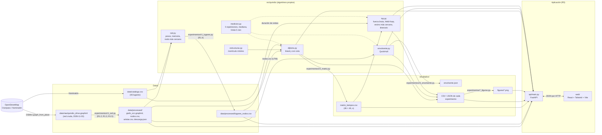
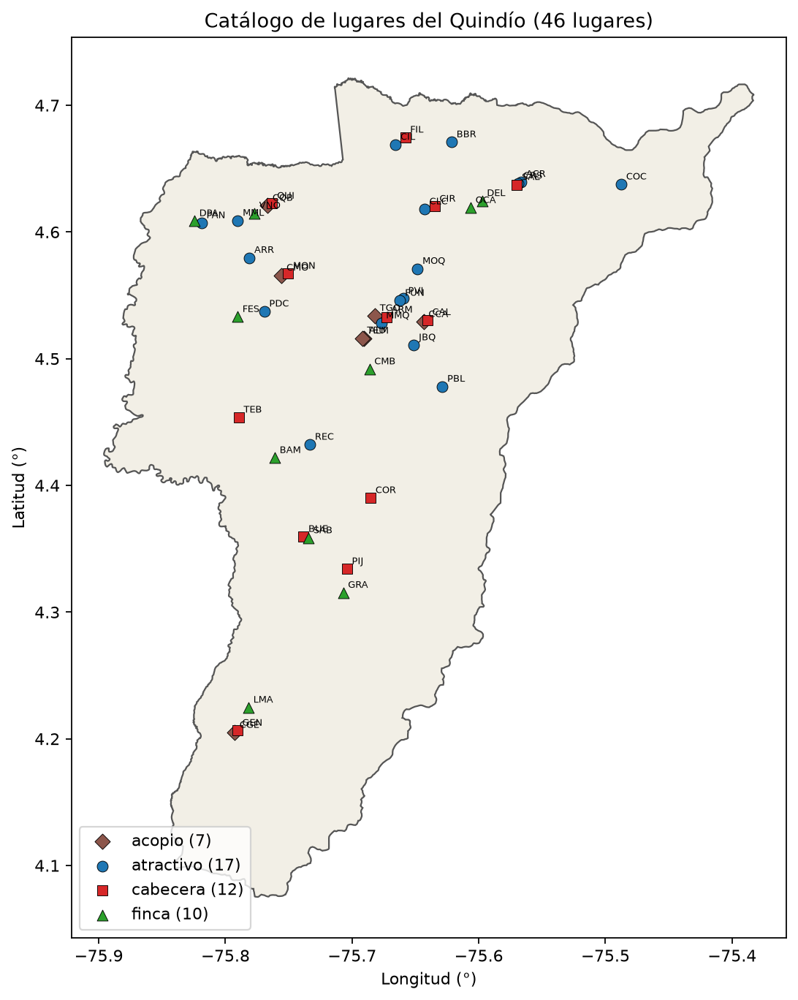
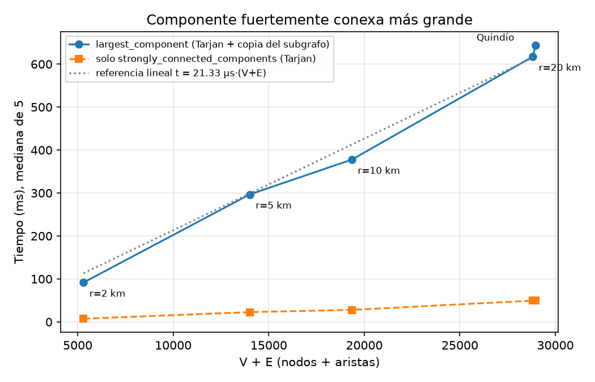
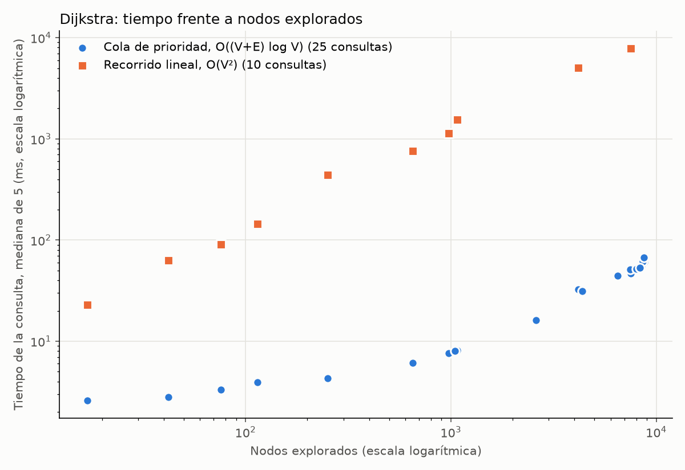
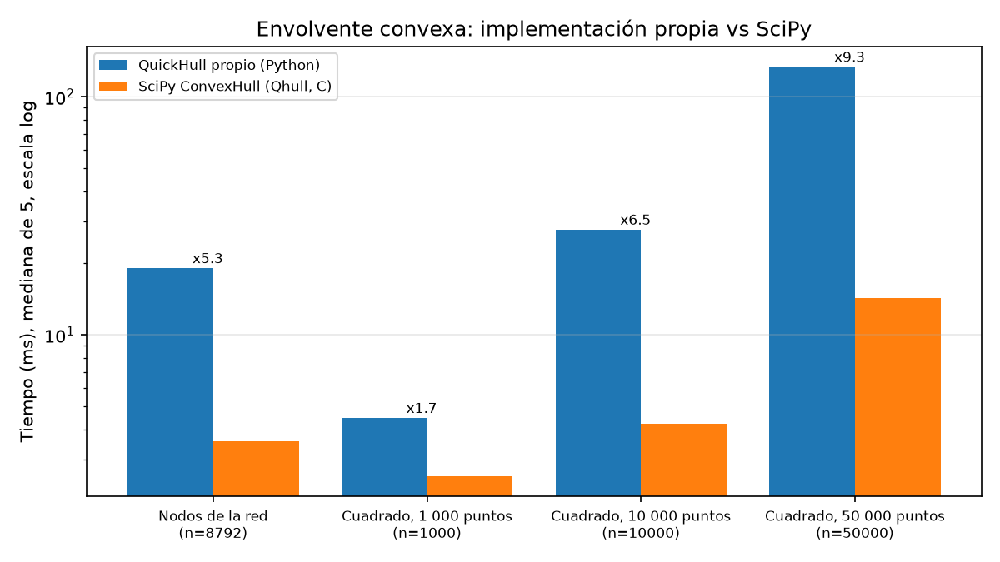
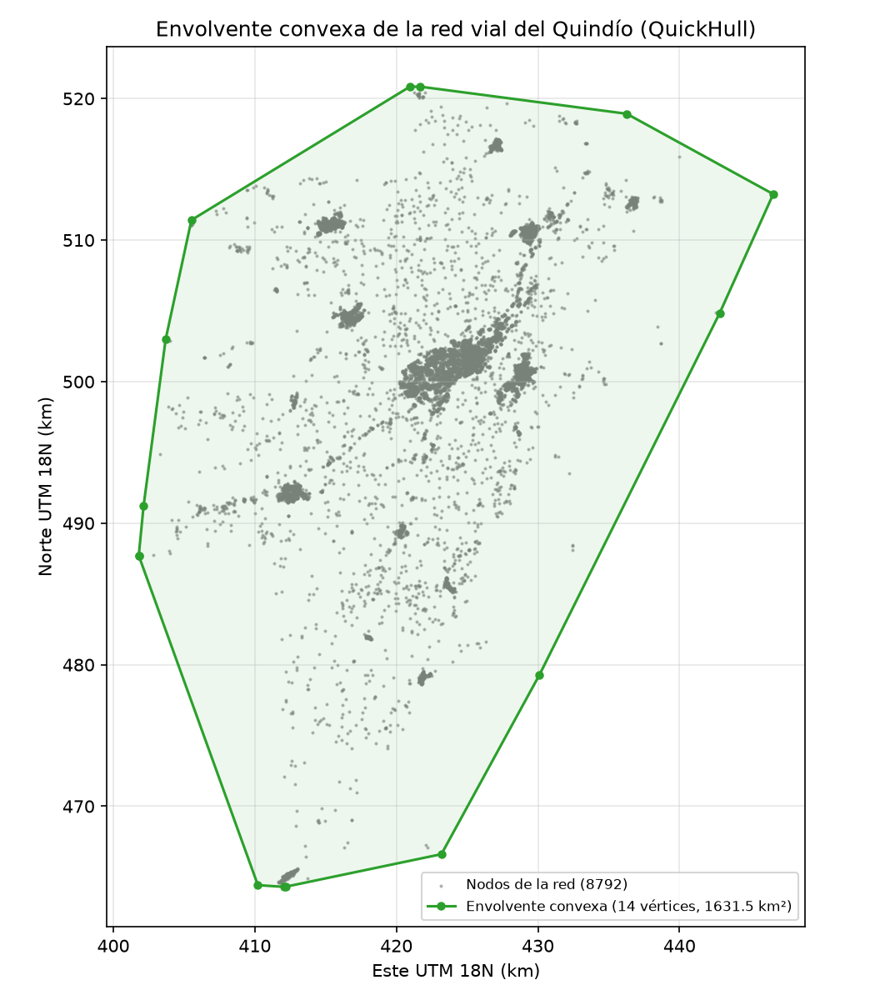
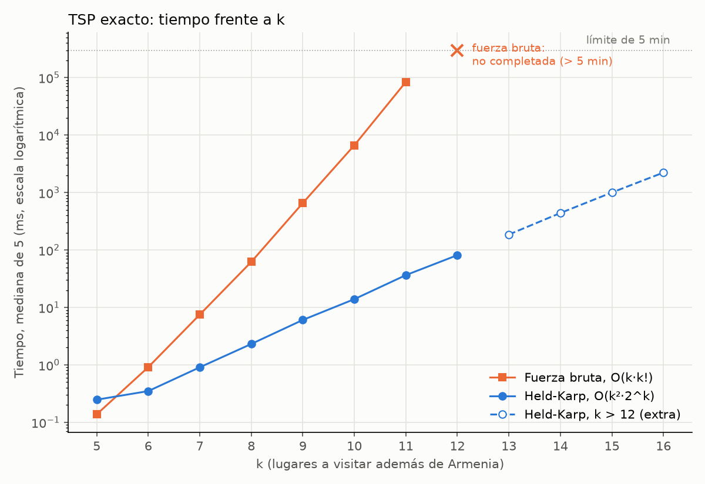

# Rutas del Paisaje Cultural Cafetero — Documento técnico

Proyecto final de Teoría de Grafos y Análisis de Algoritmos. Sistema de planificación de rutas sobre
la red vial real del Quindío: modelo de la red (R1), caminos mínimos con Dijkstra (R2), envolvente
convexa con QuickHull (R3), ruta óptima de recorrido con fuerza bruta, Held-Karp y una heurística
voraz (R4) y una aplicación web demostrativa (R5).

Todo el código está en Python. Los algoritmos de implementación propia están escritos en "método
largo" (bucles explícitos, pasos numerados que corresponden al pseudocódigo del docstring, sin
funciones de librería que resuelvan el problema). NetworkX, SciPy y Shapely se usan solo para
verificar resultados.

---

## 1. Arquitectura de la solución

### 1.1 Diagrama de componentes



### 1.2 Cómo pasan los datos de un requerimiento a otro

| Paso | Entrada | Proceso (archivo) | Salida | La usa |
|---|---|---|---|---|
| Descarga | OpenStreetMap (Overpass) | `ox.graph_from_place("Quindío, Colombia", network_type="drive")` con servidores alternos (`src/quindio/descarga.py`) | `data/raw/quindio_drive.graphml`, `data/raw/descarga.json` | R1 |
| Catálogo | Nominatim (OSM) y cuaderno base | `data/catalogo.csv`, verificado por `experimentos/catalogo.py` | 46 lugares con coordenadas y duración de visita | R1.4, R2, R4 |
| R1.2–R1.3 | red cruda | `red.asignar_pesos` + `ox.truncate.largest_component(G, strongly=True)` (`experimentos/r1_red.py`) | componente con pesos | R1.5 |
| R1.5 | componente | `experimentos/r1_red.py`, `experimentos/r1_geometrias.py` | `data/processed/grafo_scc.graphml`, `nodos.csv` (lat, lon, UTM), `aristas.csv` (u, v, distancia_m, tiempo_s, velocidad_kmh), `geometria_aristas.json` (forma real de cada tramo, solo para dibujar) | R1.4, R2, R3, app |
| R1.4 | `catalogo.csv` + `nodos.csv` | `red.asociar_lugares` (`experimentos/r1_lugares.py`) | `data/processed/lugares_nodos.csv` (lugar → nodo) | R2, app |
| R2 | `aristas.csv` (vía `red.cargar_grafo`) + `lugares_nodos.csv` | `dijkstra_cola` sin destino desde cada lugar (`experimentos/r2_matriz.py`) | `resultados/matriz_tiempos.csv` | R4, app |
| R3 | `nodos.csv` (x_utm, y_utm) | `envolvente.quickhull` (`experimentos/r3_envolvente.py`) | `resultados/envolvente.json` (14 vértices, lat/lon y UTM) | documento, figura |
| R4 | `matriz_tiempos.csv` + duraciones del catálogo | `tsp.held_karp`, `tsp.fuerza_bruta`, `tsp.vecino_mas_cercano`, `tsp.itinerario` | `resultados/r4_*.csv/json` | app |
| R5 | `aristas.csv`, `nodos.csv`, `lugares_nodos.csv`, `matriz_tiempos.csv`, `resultados/` | `api/main.py` (FastAPI) llama en el momento a `dijkstra_cola`, `quickhull`, `held_karp` y `vecino_mas_cercano`; `web/` (React) dibuja | mapa, rutas, envolvente, itinerario, tablas y gráficas | usuario |

La red no se vuelve a descargar: `data/processed/` y `resultados/` están en el repositorio y bastan
para correr R2, R3, R4 y la aplicación. `data/raw/` (red cruda y redes por radio de R1.3) está en
`.gitignore` y `experimentos/reproducir.py` la descarga solo si falta.

### 1.3 Aplicación: backend y frontend

- **Backend** `api/main.py` (FastAPI, servidor `uvicorn`, especificación en `specs/R5.md`): al
  arrancar carga una sola vez el grafo procesado (`red.cargar_grafo`), los lugares con su nodo
  (`lugares_nodos.csv`), la matriz de tiempos (`tsp.leer_matriz`) y los puntos UTM de los nodos
  (`envolvente.preparar_puntos`). No reimplementa ningún algoritmo: llama en el momento a
  `dijkstra_cola` (rutas), `quickhull` (envolvente), `held_karp` y `vecino_mas_cercano`
  (itinerario). También sirve las figuras de `resultados/figuras/` en `/figuras/` y, si existe
  `web/dist`, el frontend compilado en `/`.
- **Frontend** `web/` (React + TypeScript + Tailwind CSS + Vite; mapa con react-leaflet y
  gráficas con Recharts): vistas de ruta, envolvente, itinerario (Held-Karp vs voraz) y resultados
  de R1 a R4. Las decisiones visuales están en `web/DESIGN.md`.

Endpoints: ver la sección 2.5.1.

Ejecución (requisitos: Python 3.11 y Node 18 o superior):

```bash
# Desarrollo: dos procesos
uvicorn api.main:app --reload --port 8000        # desde la raíz del repositorio
cd web && npm install && npm run dev             # en otra terminal; abrir la URL que muestra Vite

# Un solo proceso: el backend sirve el frontend compilado
cd web && npm install && npm run build
cd .. && uvicorn api.main:app --port 8000        # abrir http://localhost:8000
```

### 1.4 Entorno de medición, fecha de los datos y protocolo

| Dato | Valor (`resultados/maquina.json`) |
|---|---|
| Procesador | 12th Gen Intel Core i5-12450H (12 núcleos lógicos) |
| Memoria RAM | 31.6 GB |
| Sistema operativo | Windows 11 Home (build 26200; Python lo reporta como `Windows-10-10.0.26200`) |
| Lenguaje | Python 3.11.15 |
| Librerías | OSMnx 2.1.1, NetworkX 3.6.1, SciPy 1.17.1 |
| Fecha de descarga de la red | **2026-11-03** (servidor `overpass-api.de`, `data/processed/descarga.json`) |
| Semilla | `config.SEMILLA = 2026` (R4 usa semillas derivadas: 2026 + k y 2026 + 100·k + i) |

Protocolo (sección 6 del enunciado), aplicado con `src/quindio/medicion.py`:

1. Todas las mediciones en la misma máquina (tabla anterior).
2. Solo se mide el algoritmo: la lectura de archivos, la generación de datos y la impresión quedan
   fuera (el grafo o la matriz ya están en memoria; `traza=None`).
3. 5 repeticiones y se reporta la mediana (`medir`); si una ejecución pasa de 1 minuto se mide una
   sola vez.
4. Todos los tiempos en **milisegundos**.
5. Datos aleatorios con semilla fija documentada en cada experimento.
6. Cada algoritmo se verifica antes de medir (caso a mano, otra implementación propia o librería).
7. Límite de 5 minutos: `medir_con_limite` ejecuta en un proceso aparte y, si no termina, se
   reporta «no completada».
8. Resultados en CSV/JSON en `resultados/`; las figuras de `resultados/figuras/` las generan
   scripts separados (`experimentos/*_figuras.py`) que leen esos archivos.

Variabilidad: la máquina tenía otros procesos activos y el i5-12450H mezcla núcleos de rendimiento
y de eficiencia; entre ejecuciones completas de un mismo experimento la mediana cambió hasta
±40–50 % (se detalla en R1 y R3), pero las tendencias y los órdenes de magnitud se mantuvieron.

**Desarrollo guiado por especificaciones.** Antes de programar cada requerimiento se escribió su
especificación en `specs/` (`catalogo.md`, `R1.md`, `R2.md`, `R3.md`, `R4.md`, `R5.md`) con
entradas, salidas, comportamiento y casos de prueba; luego las pruebas en `tests/`. Estado actual:
`python -m pytest -q tests` → **55 pruebas en verde** (catálogo 8, R1 9, R2 8, R3 7, R4 13,
API de la aplicación 10).

### 1.5 Explicación paso a paso

Cada módulo tiene un ejemplo pequeño resuelto a mano y una demostración en consola que imprime
la traza del algoritmo (desde la raíz, con `PYTHONPATH=src`):

| Requerimiento | Documento | Demostración |
|---|---|---|
| R1 (nodo más cercano, lectura de `maxspeed`, pesos) | [paso_a_paso_R1.md](paso_a_paso_R1.md) | `python -m quindio.red` |
| R2 (Dijkstra lineal y con cola, montículo) | [paso_a_paso_R2.md](paso_a_paso_R2.md) | `python -m quindio.dijkstra`, `python -m quindio.estructuras` |
| R3 (QuickHull) | [paso_a_paso_R3.md](paso_a_paso_R3.md) | `python -m quindio.envolvente` |
| R4 (permutaciones de Heap, fuerza bruta, Held-Karp, voraz) | [paso_a_paso_R4.md](paso_a_paso_R4.md) | `python -m quindio.tsp` |

En Windows conviene definir `PYTHONIOENCODING=utf-8` para que la consola muestre bien las tildes.

---

## 2. Requerimientos

### 2.0 Datos: catálogo de lugares

Archivos: `data/catalogo.csv`, `specs/catalogo.md`, `experimentos/catalogo.py`,
`tests/test_catalogo.py`, `resultados/catalogo_verificacion.csv`, `resultados/figuras/catalogo.png`.

**El problema.** Un catálogo de al menos 40 lugares reales del Quindío en cuatro categorías, con
identificador, nombre, municipio, categoría, latitud y longitud, y la duración de la visita de cada
atractivo. Las cabeceras se ubican en su plaza principal; la plaza de Bolívar de Armenia (`ARM`) es
la partida por defecto de R4.

Columnas (el anexo permite ampliarlas):
`id,nombre,municipio,categoria,lat,lon,duracion_visita_min,fuente_duracion,fuente_coordenadas`.

| Categoría | Mínimo pedido | Lugares en el catálogo | Municipios cubiertos | Distancia a su cabecera, mediana (km) | Distancia máxima (km) |
|---|---|---|---|---|---|
| Cabeceras municipales | 12 | 12 | 12 | 0.00 | 0.00 |
| Atractivos turísticos | 15 | 17 | 7 | 3.36 | 15.01 (RECUCA) |
| Fincas cafeteras u hoteles rurales | 8 | 10 | 8 | 3.95 | 15.73 (Hacienda Bambusa) |
| Centros de acopio o trilladoras | 5 | 7 | 5 | 0.59 | 2.79 |
| **Total** | **40** | **46** | 12 | | |

(Distancias en línea recta con la fórmula del semiverseno, de `resultados/catalogo_verificacion.csv`.)

**Fuentes de las coordenadas.** (1) Nominatim, el geocodificador de OpenStreetMap
(https://nominatim.openstreetmap.org/search), consultado el 2026-11-03 con una pausa de 1.1 s entre
peticiones (política de uso: máximo una por segundo) y restringido al rectángulo del Quindío; cada
fila guarda en `fuente_coordenadas` la consulta exacta y el tipo de objeto OSM devuelto. Datos ©
colaboradores de OpenStreetMap, licencia ODbL. (2) El cuaderno base
`AlgoritmosDikstra-FloydWarshall.ipynb` para las plazas de Armenia, Pijao, Filandia, Buenavista y
Quimbaya, que coinciden con Nominatim a menos de 25 m (entre 6.3 m en Quimbaya y 22.8 m en Pijao).

Decisiones: Valle de Cocora se ubicó en la vereda Cocora, donde termina la vía desde Salento;
Parque Los Arrieros se registró en Quimbaya y Hacienda Bambusa en Armenia (corregimiento El Caimo)
porque sus puntos caen en esos polígonos municipales de OSM.

**Verificación.** `experimentos/catalogo.py` comprueba con los polígonos de OSM (Shapely solo para
verificar): **46 de 46 lugares dentro del departamento** y **46 de 46 en su municipio** (en la
primera versión dos no coincidían y se corrigieron como se explicó). El mapa
`resultados/figuras/catalogo.png` dibuja los 46 puntos por categoría sobre el polígono del
departamento. Las 8 pruebas de `tests/test_catalogo.py` revisan columnas, mínimos por categoría,
`id` únicos, `ARM` con las coordenadas de `config.PLAZA_BOLIVAR_ARMENIA`, una cabecera por
municipio, rectángulo del Quindío, duraciones con fuente y distancia a la cabecera < 20 km; la
función de distancia se valida a mano (1° de latitud ≈ 111.19 km).



**Duración de las visitas.** Cinco atractivos con fuente publicada y el resto con un criterio del
grupo por tipo de lugar:

| Atractivo | Duración (min) | Justificación |
|---|---|---|
| Parque Nacional del Café (PDC) | 360 | Horario 9:00–18:00; se toman 6 de las 9 h (Semana, 2024, https://www.semana.com/turismo/articulo/parque-del-cafe-donde-queda-horarios-y-precios-de-entradas/202446/) |
| PANACA (PAN) | 360 | Tour de 6 h (Expedia, https://www.expedia.com/things-to-do/tour-panaca.a4974155.activity-details) |
| Valle de Cocora (COC) | 210 | Sendero corto de 3 a 4 h (https://www.mochileandoporelmundo.com/trekking-por-el-valle-del-cocora-colombia/) |
| Jardín Botánico del Quindío (JBQ) | 150 | Recorrido guiado de 2.5 h (Semana, https://www.semana.com/turismo/articulo/que-costo-tiene-la-entrada-y-que-se-puede-hacer-en-el-jardin-botanico-del-quindio/202549/) |
| RECUCA (REC) | 210 | Recorrido de 3 a 4 h (Pulzo, https://www.pulzo.com/vivir-bien/viajes-y-turismo/cuanto-vale-entrada-recuca-quindio-para-recorrido-cafe-unico-mundo-PP4364821) |

| Criterio | Tipo de lugar | Duración (min) | Atractivos |
|---|---|---|---|
| C1 | Mirador | 45 | CIL, ACR |
| C2 | Museo o sitio patrimonial pequeño | 90 | MOQ, CLC, MMQ |
| C3 | Parque urbano o calle patrimonial | 90 | PVI, CRS, FUN |
| C4 | Granja demostrativa pequeña | 120 | MML |
| C5 | Parque temático de medio día | 240 | ARR |
| C6 | Reserva o sendero natural corto | 180 | BBR, PBL |

Los 17 atractivos suman 2 640 min (44 h; mediana 120 min). Como la jornada de R4 es de 11 h
(660 min), un itinerario con PDC, PAN, COC o REC casi nunca cabe con 6 a 8 atractivos.

**Limitaciones.** OSM es colaborativo: un objeto mal ubicado se heredaría (los casos dudosos se
revisaron uno por uno). Las duraciones son estimaciones para planificar. Los centros de acopio son
sedes urbanas; la compra en veredas no está en OSM.

---

### 2.1 Requerimiento 1 — Modelo de la red vial

Archivos: `src/quindio/red.py`, `experimentos/r1_red.py`, `r1_scc.py`, `r1_figuras.py`,
`r1_lugares.py`, `specs/R1.md`, `tests/test_r1.py`, `docs/paso_a_paso_R1.md`.

#### 2.1.1 Representación

**Problema.** Elegir entre matriz y listas de adyacencia para un grafo dirigido con dos pesos por
arista (tiempo y distancia).

**Complejidad** (Cormen, Leiserson, Rivest y Stein, *Introduction to Algorithms*, 3.ª ed., MIT
Press, 2009, sec. 22.1): la matriz ocupa Θ(V²) memoria sin importar E; las listas, Θ(V + E).
Recorrer los vecinos de un nodo cuesta Θ(V) con matriz y Θ(grado) con listas; consultar si existe
(u, v) cuesta O(1) con matriz y O(grado) con listas.

**Supuestos** (1 MB = 10⁶ B; `resultados/r1_memoria.json`):

- Matriz, bajo nivel (C/C++): V·V celdas de 8 B (tiempo `float32` + distancia `float32`).
- Listas, bajo nivel: E entradas de 12 B (vecino `int32` + tiempo + distancia) más V índices de 8 B.
- Matriz en Python: V listas de V punteros de 8 B + 56 B de cabecera por lista (sin contar los
  `float` de las celdas con arista); se comprobó midiendo una matriz de 1 000 × 1 000 con
  `sys.getsizeof` y escalando.
- Listas en Python (medido): el `dict {nodo: [(vecino, tiempo_s, distancia_m), ...]}` que devuelve
  `red.cargar_grafo()`, sumando `sys.getsizeof` de cada objeto.

| Red | V | E | Matriz bajo nivel (MB) | Listas bajo nivel (MB) | Matriz Python (MB) | Listas Python medido (MB) |
|---|---|---|---|---|---|---|
| Red descargada | 8 808 | 20 157 | 620.65 | 0.31 | 621.14 | — |
| Componente fuertemente conexa | 8 792 | 20 136 | 618.39 | 0.31 | 618.89 (medida y escalada: 623.41) | 4.22 |

(La medición en Python usa las 19 999 aristas que quedan tras quitar 137 paralelas, ver 2.1.5.)

**Elección: listas de adyacencia.** La red es muy dispersa: E/V ≈ 2.3, y solo el 0.026 % de las
celdas de la matriz tendría arista (20 136 / 8 792²). La matriz ocuparía unas 2 000 veces más que
las listas en el modelo de bajo nivel (618 MB frente a 0.31 MB) y unas 150 veces más que el
diccionario real de Python (4.22 MB). Además Dijkstra recorre los vecinos de cada nodo extraído:
con listas eso suma Θ(V + E) en total, con matriz Θ(V²). Ningún algoritmo del proyecto necesita
consultar una arista en O(1). El costo real en Python es ≈ 13 veces el de bajo nivel porque cada
número y cada tupla es un objeto con cabecera y las listas guardan punteros.

#### 2.1.2 Pesos: distancia y tiempo

Cada arista guarda `distancia_m` (atributo `length` de OSMnx) y
`tiempo_s = distancia_m / (velocidad_kmh / 3.6)` (ej.: 1 000 m a 50 km/h → 72 s). El tiempo es una
**estimación del modelo** (velocidad de flujo libre), no el tiempo real: no considera semáforos,
giros, pendientes ni tráfico.

Velocidad de cada tramo (`red.asignar_pesos` y `red.parsear_maxspeed`, implementación propia):

1. Se lee `maxspeed` de OSM: número, con unidad (`km/h`, `mph` × 1.609344), varios valores separados
   por `|` o `;`, o lista (OSMnx fusiona tramos al simplificar) → media de los valores válidos;
   valores no numéricos (`"CO:urban"`) → sin dato. 1 307 aristas (6.5 %) tienen `maxspeed`. La
   lectura coincide con la limpieza interna de OSMnx (`_clean_maxspeed`) en las 1 307
   (`test_parseo_igual_que_osmnx_en_la_red_real`).
2. Tramo sin dato: **media de las velocidades leídas en los tramos del mismo tipo de vía**
   (`highway`), la misma regla por defecto de `ox.add_edge_speeds`, escrita a mano.
3. Tipo de vía sin ningún tramo con dato: tabla dentro de la normativa colombiana (Ley 769 de 2002,
   Código Nacional de Tránsito, arts. 106–107, modificados por la Ley 1239 de 2008 y la Ley 2251 de
   2022: 30 km/h en zonas residenciales y escolares, 50 km/h máximo en vías urbanas): `primary_link`
   40, `tertiary_link` 30, otros (`ladder`) 30 km/h.

Velocidades usadas (`resultados/r1_velocidades.csv`, aristas de la red descargada):

| Tipo de vía | Aristas | Con maxspeed | Velocidad para tramos sin dato (km/h) | Fuente |
|---|---|---|---|---|
| residential | 13 455 | 293 | 31.37 | media maxspeed del tipo |
| unclassified | 2 459 | 248 | 30.48 | media maxspeed del tipo |
| tertiary | 1 843 | 318 | 30.52 | media maxspeed del tipo |
| secondary | 1 282 | 157 | 36.31 | media maxspeed del tipo |
| primary | 564 | 166 | 44.16 | media maxspeed del tipo |
| trunk | 420 | 120 | 34.07 | media maxspeed del tipo |
| secondary_link | 48 | 4 | 30.00 | media maxspeed del tipo |
| trunk_link | 39 | 1 | 20.00 | media maxspeed del tipo |
| primary_link | 36 | 0 | 40 | tabla normativa |
| ladder | 6 | 0 | 30 | tabla normativa |
| tertiary_link | 5 | 0 | 30 | tabla normativa |

**Discusión.** El 93.5 % de las aristas de la componente (18 833 de 20 136) tiene velocidad
imputada, así que el modelo depende sobre todo de la imputación. Los tramos etiquetados en OSM
están sobre todo en zonas urbanas (en `trunk` hay 64 tramos a 30 km/h y solo 9 a 60 km/h), por eso
las medias por tipo salen bajas (34 km/h en `trunk`) y los trayectos largos por carretera
probablemente quedan sobreestimados. La velocidad de las aristas procesadas tiene mediana 31.4 km/h
(mín. 20, máx. 60). El tiempo sirve para comparar rutas, no para predecir el tiempo real.

#### 2.1.3 Componente fuertemente conexa

**Qué hace `ox.truncate.largest_component(G, strongly=True)`** (código fuente de OSMnx 2.1.1,
`osmnx/truncate.py`, función `largest_component`): (1) si `nx.is_strongly_connected(G)` devuelve
el grafo; (2) si no, `max(nx.strongly_connected_components(G), key=len)`; (3)
`nx.MultiDiGraph(G.subgraph(componente))` copia el subgrafo inducido con todos sus atributos.
`strongly_connected_components` de NetworkX 3.6.1 dice en su documentación: "Uses Tarjan's
algorithm with Nuutila's modifications. Nonrecursive version of algorithm".

**Cómo funciona** (R. E. Tarjan, "Depth-first search and linear graph algorithms", *SIAM Journal
on Computing* 1(2):146–160, 1972; E. Nuutila y E. Soisalon-Soininen, "On finding the strongly
connected components in a directed graph", *Information Processing Letters* 49(1):9–14, 1994):
un DFS iterativo (pila explícita) numera cada nodo en orden de descubrimiento (`preorder`); al
terminar v calcula `lowlink[v]`, el menor número alcanzable desde su subárbol con a lo sumo una
arista hacia un nodo sin componente asignada. Si `lowlink[v] == preorder[v]`, v es la raíz de una
componente formada por v y los nodos de la pila auxiliar con número mayor. La modificación de
Nuutila solo apila los nodos que no son raíz. Correctitud: en un DFS los nodos de cada componente
forman un subárbol cuya raíz es el primero descubierto, y esa raíz es exactamente el nodo con
`lowlink = preorder` (Tarjan 1972; Cormen et al. 2009, sec. 22.5).

**Complejidad.** Tiempo **Θ(V + E)**: cada nodo entra y sale una vez de la pila y cada arista se
examina un número constante de veces (Tarjan 1972; Cormen et al. 2009, sec. 22.5; R. Sedgewick y
K. Wayne, *Algorithms*, 4.ª ed., Addison-Wesley, 2011, sec. 4.2). Memoria **Θ(V)** adicional
(`preorder`, `lowlink`, iteradores, pilas). La función completa suma la copia del subgrafo,
Θ(V + E) en tiempo y memoria, con una constante grande por copiar los diccionarios de atributos.

**Medición** (`experimentos/r1_scc.py`). Redes `ox.graph_from_point(PLAZA_BOLIVAR_ARMENIA,
dist=r, network_type="drive")` con r = 2, 5, 10 y 20 km (descargadas el 2026-11-03; `dist` es la
mitad del lado de un cuadrado, por eso la de 20 km incluye vías de Valle del Cauca y Risaralda) y la
red completa. Se mide solo la función (no la lectura del GraphML), 5 repeticiones, mediana, cada red
cargada sola en memoria. También se mide aparte `max(nx.strongly_connected_components(G), key=len)`
(solo Tarjan). Antes de guardar se verifica que la componente sea fuertemente conexa y tenga los
mismos nodos que la de Tarjan.

Tiempo de obtener la componente (`resultados/r1_scc_tiempos.csv`, **tiempos en ms**):

| Red | V | E | V + E | Tiempo (ms) | Solo Tarjan (ms) | Nodos componente | Aristas componente | Tiempo/(V+E) (µs) |
|---|---|---|---|---|---|---|---|---|
| Radio de 2 km | 1 648 | 3 657 | 5 305 | 91.61 | 7.47 | 1 579 | 3 538 | 17.3 |
| Radio de 5 km | 4 297 | 9 708 | 14 005 | 296.68 | 22.67 | 4 261 | 9 654 | 21.2 |
| Radio de 10 km | 5 943 | 13 405 | 19 348 | 377.65 | 27.92 | 5 911 | 13 355 | 19.5 |
| Radio de 20 km | 8 773 | 20 047 | 28 820 | 617.39 | 49.51 | 8 751 | 20 016 | 21.4 |
| Departamento completo | 8 808 | 20 157 | 28 965 | 643.63 | 49.33 | 8 792 | 20 136 | 22.2 |



Gráfica generada por `experimentos/r1_figuras.py` desde el CSV, con la recta de referencia
t = c·(V + E) ajustada por mínimos cuadrados (c ≈ 21.3 µs).

**Discusión.** Coincide con la complejidad lineal: de la red de 2 km al departamento V + E crece
5.5 veces y el tiempo 7.0 veces (solo Tarjan: 6.6 veces); el costo por unidad de V + E se mantiene
en un rango estrecho (17–22 µs la función completa, 1.4–1.7 µs Tarjan) en vez de crecer con el
tamaño, como pasaría con un algoritmo cuadrático. El ligero aumento del costo unitario se explica
por la caché (los diccionarios del grafo, de decenas de MB, dejan de caber) y por el recolector de
basura de Python, que trabaja más mientras se crean los objetos de la copia. Las redes de 20 km y
del departamento tienen casi el mismo tamaño y tiempos parecidos: el tiempo depende de V + E, no
de la zona. En promedio el **92 % del tiempo es la copia del subgrafo**, no Tarjan; ambas partes
son lineales, pero la copia tiene una constante unas 13 veces mayor. Variabilidad: con otros
procesos activos, la mediana de una misma red varió hasta ±40 % entre ejecuciones completas; la
ejecución anterior del script final dio 82, 284, 358, 634 y 543 ms, con la misma tendencia lineal.

**Por qué trabajar solo con la componente.** Entre dos nodos de la componente siempre hay un camino
dirigido, así que toda consulta de R2 tiene solución y la matriz de tiempos queda finita (se
comprobó: ninguna celda infinita). En R4 todo recorrido existe y los tres métodos no tienen que
tratar casos sin solución. En la red cruda hay nodos sin salida o sin entrada (bordes del
departamento, sentidos únicos cortados) que dejarían rutas imposibles. El costo es mínimo: se
pierden 16 nodos (0.18 %) y 21 aristas (0.10 %).

#### 2.1.4 Ubicación de los lugares

`red.asociar_lugares` (implementación propia, búsqueda lineal en `red.nodo_mas_cercano`):

1. Convierte (lat, lon) a metros en UTM 18N (EPSG:32618) con pyproj; los nodos ya tienen
   `x_utm`, `y_utm` en `nodos.csv`.
2. Para cada lugar recorre **todos** los nodos y se queda con el de menor distancia euclidiana,
   comparando el cuadrado de la distancia (`dx² + dy²`) para no sacar raíces.
3. Agrega `nodo`, `dist_nodo_m` y `lejano_500m`.

**Complejidad.** Tiempo Θ(L·V) para L lugares (46 × 8 792 ≈ 404 000 comparaciones); memoria
Θ(V + L). Un árbol k-d (J. L. Bentley, "Multidimensional binary search trees used for associative
searching", *Communications of the ACM* 18(9), 1975), que usa `ox.distance.nearest_nodes`, bajaría
cada consulta a O(log V) en promedio, pero no se justifica para 46 consultas.

**Correctitud.** Invariante: después de revisar i nodos, `mejor` es el más cercano entre esos i;
al revisar los V, es el mínimo global.

**Verificación.** Cuadrícula sintética de 5 × 5 nodos resuelta a mano (50 m, 0 m, 600 m); 40
lugares al azar (semilla 2026) frente a `ox.distance.nearest_nodes` en UTM; y el script compara de
nuevo con `nearest_nodes` antes de guardar: **mismo nodo en los 46 lugares**. Distancia al nodo:
mediana 75.0 m, mínimo 6.4 m, máximo 1 178.0 m.

Lugares a más de 500 m (`resultados/r1_lugares_lejanos.csv`):

| id | Lugar | Categoría | Nodo | Distancia al nodo (m) |
|---|---|---|---|---|
| BBR | Reserva Natural Barbas Bremen | atractivo | 2734445328 | 1 178.0 |
| COC | Valle de Cocora | atractivo | 1543526033 | 934.0 |
| FES | Finca Hotel La Esperanza | finca | 10149145145 | 800.7 |
| PBL | Peñas Blancas | atractivo | 4612341644 | 758.8 |
| GRA | Finca Cafetera La Granada | finca | 7623496803 | 741.7 |
| CMB | Combia Finca Hotel | finca | 6387018054 | 710.0 |
| REC | RECUCA - Recorrido de la Cultura Cafetera | atractivo | 6334517962 | 596.7 |

**Tratamiento.** Son reservas, miradores o fincas rurales a las que se llega por caminos privados,
destapados o senderos que OSM no clasifica como vía para carro (`network_type="drive"` deja fuera
`track` y `path`). Las coordenadas son correctas (verificadas en el catálogo), así que se
**conservan asociados a su nodo más cercano**: el tiempo de una ruta hacia ellos es el tiempo hasta
ese nodo. El último tramo no modelado es como mucho 1.2 km (≈ 2.4 min a 30 km/h), poco frente a
los tiempos entre lugares (mediana 43.9 min).

#### 2.1.5 Grafo procesado

`experimentos/r1_red.py` guarda, para no volver a descargar:

- `data/processed/grafo_scc.graphml`: la componente con `length`, `speed_kph`, `travel_time` y
  `velocidad_imputada`.
- `data/processed/nodos.csv`: `osmid,lat,lon,x_utm,y_utm` (8 792 filas).
- `data/processed/aristas.csv`: `u,v,distancia_m,tiempo_s,velocidad_kmh` (19 999 filas). La
  MultiDiGraph tiene 137 aristas paralelas (mismo u→v, otro tramo físico); para caminos mínimos
  solo importa la más rápida, así que se conserva la de menor tiempo (20 136 → 19 999).
- `data/processed/geometria_aristas.json` (de `r1_geometrias.py`): OSMnx simplifica la red, así
  que cada arista va de una intersección a otra y guarda la forma de la vía (curvas intermedias)
  en su atributo `geometry`. Este archivo conserva esa forma ("u,v" → lista de [lat, lon]) para
  11 374 de las 19 999 aristas (las demás son rectas). No interviene en ningún algoritmo: solo
  lo usa la aplicación para que la ruta dibujada siga la vía en lugar de unir intersecciones
  con líneas rectas.
- `data/processed/lugares_nodos.csv` (de `r1_lugares.py`) y `data/processed/descarga.json`.
- `red.cargar_grafo()` lee los CSV y devuelve `adj[u] = [(v, tiempo_s, distancia_m), ...]` en
  0.19 s.

Tamaño de la red antes y después de filtrar (`resultados/r1_tamano.csv`):

| Red | Nodos | Aristas |
|---|---|---|
| Red descargada | 8 808 | 20 157 |
| Componente fuertemente conexa | 8 792 | 20 136 |

**Discusión.** La red descargada ya es casi fuertemente conexa: solo quedan fuera 16 nodos y 21
aristas en los bordes del polígono o en sentidos únicos sin regreso. Filtrar no cambia el tamaño de
forma apreciable, pero garantiza que todas las rutas existan.

#### 2.1.6 Verificación de R1

| Prueba (`tests/test_r1.py`) | Qué comprueba |
|---|---|
| `test_parsear_maxspeed_casos_a_mano` | números, unidades, mph, `|`, `;`, listas, valores no numéricos y nulos |
| `test_parseo_igual_que_osmnx_en_la_red_real` | la lectura propia coincide con la de OSMnx en las 1 307 aristas con `maxspeed` |
| `test_asignar_pesos_imputacion_y_tiempo` | tiempo = distancia / velocidad; imputación por media del tipo; tabla normativa |
| `test_estimar_memoria_caso_pequeno` | V = 2, E = 1 → matriz 32 B, listas 28 B |
| `test_asociar_lugares_cuadricula_a_mano` | nodo y distancia en la cuadrícula resuelta a mano; marca de > 500 m |
| `test_asociar_lugares_igual_que_nearest_nodes` | mismo resultado que `ox.distance.nearest_nodes` |
| `test_nodo_mas_cercano_y_leer_numero_metodo_largo` | las funciones en método largo dan lo mismo que el ejemplo a mano |
| `test_componente_procesada_fuertemente_conexa` | con NetworkX: el grafo de los CSV es fuertemente conexo y tiene los nodos de la componente |
| `test_cargar_grafo_completo_y_rapido` | carga en < 2 s, todos los nodos y aristas, velocidades entre 5 y 130 km/h |

Al reescribir las funciones en método largo se comparó la versión anterior con la nueva: 0
diferencias en las 20 157 aristas y en los 46 lugares.

---

### 2.2 Requerimiento 2 — Caminos mínimos

Archivos: `src/quindio/dijkstra.py`, `src/quindio/estructuras.py`, `experimentos/r2_dijkstra.py`,
`r2_matriz.py`, `r2_figuras.py`, `specs/R2.md`, `tests/test_r2.py`, `docs/paso_a_paso_R2.md`.

**El problema.** En la componente de R1 (V = 8 792, E = 19 999 en `aristas.csv`) con peso = tiempo
de viaje en segundos, encontrar el tiempo mínimo y la ruta entre dos lugares, y la matriz de tiempos
entre todos los lugares (46 × 46).

#### 2.2.1 Algoritmos (implementación propia)

Dijkstra (E. W. Dijkstra, "A note on two problems in connexion with graphs", *Numerische
Mathematik* 1:269–271, 1959; Cormen et al. 2009, sec. 24.3). Ninguna versión usa NetworkX, SciPy
ni `heapq`; la cola de prioridad es el montículo propio `MonticuloMinimo`.

Pseudocódigo común: (1) `d[v] = ∞`, `pred[v] = ninguno`, `explorado[v] = falso`; `d[origen] = 0`.
(2) Repetir: elegir el no explorado u de menor `d`; si no hay ninguno con `d` finita, parar
(inalcanzable); marcar u como explorado y contarlo; si u es el destino, parar; relajar cada arista
(u, v, t): si `d[u] + t < d[v]`, `d[v] = d[u] + t` y `pred[v] = u`. (3) Reconstruir la ruta desde
el destino siguiendo `pred`. Ambas devuelven `(tiempo_s, ruta, nodos_explorados)` y cada nodo se
cuenta una sola vez, la primera vez que se elige.

**Versión lineal** (`dijkstra_lineal`): el mínimo se busca recorriendo todos los nodos.

- Tiempo: hasta V iteraciones × V para buscar el mínimo + O(E) relajaciones →
  **O(V² + E) = O(V²)**; con parada temprana tras k nodos, Θ(k·V). Fuente: Cormen et al. 2009,
  sec. 24.3 (cola guardada en un arreglo indexado por vértice: EXTRACT-MIN cuesta O(V)).
- Memoria: **O(V)** (distancia, predecesor, explorado).

**Versión con cola de prioridad** (`dijkstra_cola`): montículo binario mínimo con **inserción
perezosa**: cuando `d[v]` mejora se inserta `(d[v], v)` sin borrar el viejo; un par cuyo nodo ya
está explorado es obsoleto y se descarta sin contarlo. Sin destino recorre todo el grafo (modo
uno-a-todos de la matriz).

- Montículo (`estructuras.MonticuloMinimo`): arreglo con hijos de i en 2i + 1 y 2i + 2; `insertar`
  y `extraer_minimo` recorren a lo sumo la altura ⌊log₂ n⌋ → **O(log n)** por operación, memoria
  O(n) (Cormen et al. 2009, sec. 6.1 y 6.5).
- Tiempo de Dijkstra: como mucho E + 1 inserciones y extracciones, cada una O(log E) = O(log V)
  (E ≤ V² ⇒ log E ≤ 2 log V), más la inicialización O(V): **O((V + E) log V)** (Cormen et al.
  2009, sec. 24.3; la variante perezosa en Sedgewick y Wayne 2011, sec. 4.4: espacio O(E), tiempo
  O(E log E) en el peor caso).
- Memoria: **O(V + E)** (diccionarios de V entradas + hasta E + 1 pares en el montículo).

**Recurrencia.** Dijkstra no es recursivo; su correctitud descansa en la ecuación de los caminos
mínimos (principio de optimalidad, Cormen et al. 2009, lema 24.1: todo subcamino de un camino
mínimo es mínimo):

δ(s, s) = 0,  δ(s, v) = min sobre las aristas (u, v) de { δ(s, u) + w(u, v) }.

Dijkstra la evalúa en orden creciente de δ.

#### 2.2.2 Correctitud

- **Invariante** (Cormen et al. 2009, teorema 24.6): cuando un nodo u se marca como explorado,
  `d[u] = δ(origen, u)`. Además `d[v] ≥ δ(origen, v)` siempre (lema 24.11, cota superior) y `d[v]`
  es el mínimo sobre caminos cuyos nodos intermedios están todos explorados.
- **Por qué se cumple.** Sea u el primer nodo explorado con `d[u] > δ(s, u)`. En un camino mínimo
  de s a u, sea y el primer nodo no explorado y x su anterior (explorado). Al explorar x se relajó
  (x, y), así que `d[y] = δ(s, y)`. Con pesos no negativos, δ(s, y) ≤ δ(s, u) < d[u]; pero el
  algoritmo eligió u y no y, o sea `d[u] ≤ d[y]`. Contradicción.
- **Por qué se puede parar al sacar el destino.** Por el invariante, en ese momento
  `d[destino] = δ(origen, destino)`; lo que queda solo explora nodos con distancia ≥ d[destino] y
  no puede bajarla. Ahorra mucho en consultas cortas (17 nodos explorados de 8 792 en DPA → PAN).
- **Condición sobre los pesos: no negativos.** Con un peso negativo, un nodo con `d` mayor podría
  llevar a u por un camino más barato después de fijado u, y el argumento falla. Aquí los pesos son
  tiempos de viaje: se comprobó que `tiempo_s > 0` en todas las aristas.
- **Inserción perezosa.** Un par obsoleto (d', v) con v explorado tiene d' ≥ d[v] y se descarta;
  cada nodo se explora una sola vez y con su menor prioridad.

#### 2.2.3 Verificación

- `tests/test_r2.py` (8 pruebas): grafo de 6 nodos resuelto a mano (A→F = 12, ruta A-C-B-D-E-F,
  6 explorados) en las dos versiones; uno-a-todos a mano; destino inalcanzable → (∞, [], 3);
  `traza` no cambia el resultado; grafo aleatorio de 300 nodos (semilla 2026) con mismo tiempo y
  mismos explorados en ambas versiones e igual a `nx.dijkstra_path_length` y
  `nx.single_source_dijkstra_path_length`; el montículo saca los mismos elementos en el mismo orden
  que `heapq` (solo en la prueba).
- **En la red real, antes de medir** (`resultados/r2_verificacion.csv`): en los 25 pares la versión
  con cola da el mismo tiempo que NetworkX y en los 10 pares cercanos la lineal da el mismo tiempo
  que la de cola: **diferencia máxima 0.0 s**. En esos 10 pares las dos versiones exploran también
  el mismo número de nodos.
- **Matriz**: cada fila se compara con `nx.single_source_dijkstra_path_length`: diferencia máxima
  0.0 s en las 46 × 46 celdas.

**Elección de los pares** (semilla 2026, `random.Random(2026)`): 10 pares cercanos = ambos lugares
del mismo municipio y en nodos distintos, elegidos al azar entre todos los pares ordenados que
cumplen eso (quedaron de Salento, Quimbaya, Armenia, Calarcá y Génova); se miden con ambas
versiones. Otros 15 pares al azar entre municipios distintos, solo con cola. Total con cola: 25.

#### 2.2.4 Resultados

Mediciones de Dijkstra (`resultados/r2_dijkstra.csv`; columnas del anexo más `tipo_par` y
municipios; **tiempo en ms**, tiempo de viaje en s). Todas se completaron dentro de 5 min.

| origen | destino | version | tiempo_viaje_s | nodos_explorados | tiempo_ms | par |
|---|---|---|---|---|---|---|
| SAL | ACR | cola_prioridad | 53.45 | 42 | 2.825 | cercano (Salento) |
| SAL | ACR | lineal | 53.45 | 42 | 63.187 | cercano (Salento) |
| ARR | CQB | cola_prioridad | 500.82 | 114 | 3.941 | cercano (Quimbaya) |
| ARR | CQB | lineal | 500.82 | 114 | 144.886 | cercano (Quimbaya) |
| DEL | COC | cola_prioridad | 2019.85 | 1076 | 8.143 | cercano (Salento) |
| DEL | COC | lineal | 2019.85 | 1076 | 1545.266 | cercano (Salento) |
| DEL | OCA | cola_prioridad | 1265.70 | 252 | 4.315 | cercano (Salento) |
| DEL | OCA | lineal | 1265.70 | 252 | 442.555 | cercano (Salento) |
| ALM | MOQ | cola_prioridad | 857.19 | 4172 | 32.462 | cercano (Armenia) |
| ALM | MOQ | lineal | 857.19 | 4172 | 5046.368 | cercano (Armenia) |
| QUI | DPA | cola_prioridad | 995.84 | 977 | 7.597 | cercano (Quimbaya) |
| QUI | DPA | lineal | 995.84 | 977 | 1137.346 | cercano (Quimbaya) |
| MOQ | BAM | cola_prioridad | 2380.26 | 7531 | 46.889 | cercano (Armenia) |
| MOQ | BAM | lineal | 2380.26 | 7531 | 7804.492 | cercano (Armenia) |
| CMB | CAL | cola_prioridad | 882.22 | 654 | 6.100 | cercano (Calarcá) |
| CMB | CAL | lineal | 882.22 | 654 | 760.361 | cercano (Calarcá) |
| LMA | GEN | cola_prioridad | 365.11 | 76 | 3.302 | cercano (Génova) |
| LMA | GEN | lineal | 365.11 | 76 | 90.748 | cercano (Génova) |
| DPA | PAN | cola_prioridad | 129.35 | 17 | 2.607 | cercano (Quimbaya) |
| DPA | PAN | lineal | 129.35 | 17 | 22.791 | cercano (Quimbaya) |
| ARR | CGE | cola_prioridad | 7013.13 | 8750 | 61.739 | Quimbaya → Génova |
| ALM | COC | cola_prioridad | 3909.26 | 8597 | 57.624 | Armenia → Salento |
| MMQ | SAB | cola_prioridad | 2784.50 | 8050 | 52.537 | Armenia → Buenavista |
| FUN | PAN | cola_prioridad | 2741.05 | 8005 | 52.519 | Armenia → Quimbaya |
| CQB | FUN | cola_prioridad | 1927.82 | 4374 | 31.476 | Quimbaya → Armenia |
| GRA | CMB | cola_prioridad | 3288.09 | 1045 | 8.056 | Pijao → Calarcá |
| FES | CGE | cola_prioridad | 6132.30 | 8748 | 60.292 | Montenegro → Génova |
| FES | PBL | cola_prioridad | 2967.32 | 7492 | 50.967 | Montenegro → Calarcá |
| MML | ACR | cola_prioridad | 3756.95 | 8030 | 51.753 | Quimbaya → Salento |
| LMA | DPA | cola_prioridad | 7737.80 | 8499 | 55.451 | Génova → Quimbaya |
| FES | GRA | cola_prioridad | 5006.92 | 8607 | 61.586 | Montenegro → Pijao |
| OCA | ARR | cola_prioridad | 2899.53 | 6492 | 44.520 | Salento → Quimbaya |
| CRS | ARM | cola_prioridad | 2271.86 | 2603 | 16.170 | Salento → Armenia |
| SAL | SAB | cola_prioridad | 4927.06 | 8322 | 53.481 | Salento → Buenavista |
| ARM | GEN | cola_prioridad | 5807.70 | 8723 | 67.338 | Armenia → Génova |

**Discusión.** Los nodos explorados dependen del tiempo de viaje del par, no del municipio ni de la
distancia en línea recta: Dijkstra avanza "en círculos de tiempo" alrededor del origen, así que una
consulta de 129 s explora 17 nodos y una de 7 000 s casi toda la red (8 750 de 8 792). "Mismo
municipio" no siempre es poco trabajo: MOQ → BAM (casco urbano de Armenia → corregimiento El Caimo)
exploró 7 531, y ALM → MOQ (857 s) explora 4 172 porque el casco urbano de Armenia es denso,
mientras QUI → DPA (996 s, zona rural de Quimbaya) explora 977. Coincide con la teoría: los nodos
salen en orden creciente de distancia y el algoritmo para en el destino.



Gráfica generada por `experimentos/r2_figuras.py` desde `r2_dijkstra.csv`; nodos explorados en x,
tiempo en ms en y, ambos ejes logarítmicos (los datos cubren tres órdenes de magnitud).

**Discusión de la gráfica.** Con V fijo (8 792), la teoría da para la versión lineal Θ(k·V), lineal
en k: en log-log, pendiente 1. El ajuste por mínimos cuadrados da **pendiente 0.96** y el costo por
nodo revisado, tiempo / (k·V), queda entre 118 y 200 ns (mediana 141 ns): cada paso recorre los
8 792 nodos aunque solo se exploren 17. En la versión con cola la pendiente cruda es 0.59, menor de
lo esperado para O(k log k), por un **piso fijo de ≈ 2.5 ms** que no depende de k: la inicialización
O(V) de los tres diccionarios (la consulta más corta, con 17 nodos, ya tarda 2.607 ms). Restando
2.52 ms la pendiente sube a **0.97** y el costo por unidad de k·log₂ k queda en ≈ 0.52 µs
(mediana), consistente con O((k + relajaciones) log k) + O(V). La separación vertical de dos órdenes
de magnitud refleja que la lineal paga V comparaciones por nodo explorado y la de cola solo
O(log V) más sus relajaciones.

Cociente entre versiones en los 10 pares medidos con ambas (`resultados/r2_cociente.csv`; cociente
= tiempo lineal / tiempo cola, adimensional):

| Mediana | Mínimo | Máximo |
|---|---|---|
| 113.61 | 8.74 | 189.77 |

Detalle (`resultados/r2_cociente_pares.csv`, tiempos en ms):

| origen | destino | nodos explorados | lineal (ms) | cola (ms) | cociente |
|---|---|---|---|---|---|
| DPA | PAN | 17 | 22.791 | 2.607 | 8.74 |
| SAL | ACR | 42 | 63.187 | 2.825 | 22.37 |
| LMA | GEN | 76 | 90.748 | 3.302 | 27.48 |
| ARR | CQB | 114 | 144.886 | 3.941 | 36.76 |
| DEL | OCA | 252 | 442.555 | 4.315 | 102.56 |
| CMB | CAL | 654 | 760.361 | 6.100 | 124.65 |
| QUI | DPA | 977 | 1137.346 | 7.597 | 149.71 |
| DEL | COC | 1076 | 1545.266 | 8.143 | 189.77 |
| ALM | MOQ | 4172 | 5046.368 | 32.462 | 155.45 |
| MOQ | BAM | 7531 | 7804.492 | 46.889 | 166.45 |

**Discusión del cociente.** La versión con cola siempre es más rápida y la ventaja crece con k, como
predice la teoría: el cociente es aproximadamente (k·V) / (V + k log k). Con k pequeño el
denominador lo domina el piso de 2.5 ms y la lineal paga ≈ 1.2 ms por nodo explorado, así que el
cociente crece casi proporcional a k (17 nodos → 8.7; 42 → 22.4; 114 → 36.8). Con k grande el
modelo ideal tiende a V / log₂ V ≈ 670, pero lo medido se estabiliza en 150–190 porque las
operaciones del montículo escrito en Python (llamadas a métodos, intercambios en la lista) cuestan
más que un paso del recorrido lineal, y la inserción perezosa mete más pares que nodos. El máximo
(189.8, DEL → COC) no es el par con más nodos: en ALM → MOQ y MOQ → BAM el costo por nodo de la cola
crece (≈ 5.2 µs con k ≈ 1 000 frente a 5.9–7.2 µs con k = 4 000–7 500, por el factor log k y un
montículo más grande), mientras en la lineal baja (118 ns por nodo revisado con k = 7 531 frente a
163 ns con k = 1 076), porque para los nodos ya explorados se salta la comparación de distancia.

**Matriz de tiempos** (`resultados/matriz_tiempos.csv`): 46 × 46, primera fila y primera columna =
ids, celda (i, j) = segundos de i a j. Se construye con `dijkstra_cola` sin destino, una vez desde
cada lugar. Resumen (`resultados/r2_matriz_resumen.json`):

| Medida | Valor |
|---|---|
| Lugares | 46 (46 ejecuciones uno-a-todos) |
| Tiempo total de construcción (mediana de 5) | 2 612.5 ms |
| Tiempo por fila | 56.79 ms |
| Tiempo máximo en la matriz | 9 382.75 s (156.4 min) |
| Mediana fuera de la diagonal | 43.9 min |
| Asimetría máxima \|t_ij − t_ji\| | 545.33 s, FIL ↔ BBR (FIL → BBR 1 213.11 s; BBR → FIL 1 758.44 s) |
| Asimetría media (1 035 pares) | 50.29 s |
| Asimetría relativa máxima | 65.7 % |
| Diferencia máxima con NetworkX | 0.0 s |

**Discusión de la matriz.** Una ejecución uno-a-todos explora los 8 792 nodos y cuesta ≈ 57 ms, en
línea con las consultas punto a punto que exploraron casi toda la red (55–67 ms con 8 500–8 750
nodos). Correr 46 × 45 consultas punto a punto costaría hasta 45 veces más; por eso se usa el modo
sin destino. La matriz **no es simétrica** porque la red es dirigida: en el par más asimétrico, la
ruta FIL → BBR mide 11.5 km y 11 de sus 15 tramos no tienen arista en sentido contrario, así que la
vuelta toma otra ruta de 17.9 km. Por eso R4 usa t_ij y t_ji por separado.

**Supuestos y limitaciones.** Los tiempos son entre los nodos asociados a los lugares (los 7 lugares
lejanos no incluyen el último tramo) y usan velocidades de flujo libre. La inicialización O(V) se
incluye en ambas versiones, como INITIALIZE-SINGLE-SOURCE de Cormen et al.; una inicialización
perezosa quitaría el piso de 2.5 ms, pero se dejó la forma del libro por claridad.

---

### 2.3 Requerimiento 3 — Envolvente convexa de la red vial

Archivos: `src/quindio/envolvente.py`, `experimentos/r3_envolvente.py`, `r3_figuras.py`,
`specs/R3.md`, `tests/test_r3.py`, `docs/paso_a_paso_R3.md`.

**El problema.** La envolvente convexa de los nodos de la componente (puntos del plano) aproxima la
extensión de la red vial.

**Coordenadas** (`preparar_puntos`): UTM 18N (metros), redondeo al entero más cercano y
eliminación de repetidos (O(n) esperado con un conjunto hash). Los 8 792 nodos dan **8 792 puntos
distintos**. El giro se decide con el producto cruz `(b−a)×(c−a)` (Cormen et al. 2009, sec. 33.1):
positivo = izquierda, negativo = derecha, cero = alineados. Con enteros el resultado es exacto. Los
`int` de Python tienen precisión ilimitada (documentación de Python, *Built-in Types*, *Numeric
Types*, https://docs.python.org/3/library/stdtypes.html); en un lenguaje con enteros fijos se
usarían 64 bits: las diferencias de coordenadas son del orden de 10⁵ m y los productos de
10¹⁰–10¹², por debajo de 9.2·10¹⁸ (64 bits) pero por encima de 2.1·10⁹ (32 bits). Los puntos
alineados sobre un lado no son vértices.

#### 2.3.1 Elección: QuickHull (divide y vencerás)

- La envolvente tiene **pocos vértices** (h = 14 para n = 8 792).
- Los puntos están **concentrados en los cascos urbanos**, lejos del borde. QuickHull descarta en
  cada paso los puntos dentro del triángulo formado por un lado y el punto más lejano, así que la
  mayoría desaparece en el primer nivel. Medido (`resultados/r3_niveles.csv`): de 8 790 candidatos
  del primer nivel se descartan 8 246 (**93.8 %**).
- Es más simple de explicar y programar que la mezcla de Preparata-Hong, que necesita las tangentes
  superior e inferior de dos polígonos y siempre divide hasta conjuntos de tamaño constante aunque
  casi todos los puntos sean interiores.

Fuentes: C. B. Barber, D. P. Dobkin y H. Huhdanpaa, "The Quickhull algorithm for convex hulls",
*ACM Transactions on Mathematical Software* 22(4):469–483, 1996; F. P. Preparata y M. I. Shamos,
*Computational Geometry: An Introduction*, Springer, 1985, cap. 3.

Algoritmo (`quickhull`): (1) A = punto de menor (x, y), B = de mayor (x, y); ambos son vértices.
(2) Dividir en *abajo* (a la derecha de A→B) y *arriba* (a la izquierda); los alineados con AB se
descartan. (3) Para cada lado P→Q con sus candidatos: si no hay, P→Q es lado de la envolvente; si
no, C = el candidato más lejano de la recta PQ (vértice); los candidatos a la derecha de P→C van al
subproblema (P, C), los de C→Q a (C, Q) y los del triángulo P-C-Q se descartan. (4) Los vértices
salen en orden antihorario desde A. En lugar de recursión se usa una pila explícita (en el peor caso
la profundidad es O(n) y Python limita la recursión a ≈ 1 000 llamadas).

#### 2.3.2 Complejidad

- **Recurrencia**: T(n) = T(n₁) + T(n₂) + O(n), con n₁ + n₂ ≤ n − 1 (el O(n) es buscar el más
  lejano y repartir los candidatos) (Preparata y Shamos 1985, cap. 3; Barber et al. 1996).
- **Tiempo**: con divisiones balanceadas **O(n log n)** (caso promedio); con divisiones muy
  desbalanceadas, T(n) = T(n − 1) + O(n) = **O(n²)** en el peor caso (p. ej. puntos sobre una
  circunferencia). También vale O(n·h), sensible a la salida (Barber et al. 1996).
- **Cota inferior**: Ω(n log n) para envolventes por comparaciones (Preparata y Shamos 1985, cap. 3;
  Cormen et al. 2009, sec. 33.3) y Ω(n log h) según la salida (D. G. Kirkpatrick y R. Seidel, "The
  ultimate planar convex hull algorithm?", *SIAM Journal on Computing* 15(1), 1986).
- **Memoria**: **O(n)**: cada punto vivo está en una sola lista de candidatos; la salida es O(h).
- Auxiliares: `orientacion` O(1), `preparar_puntos` O(n), `quitar_colineales` y `area_km2` O(h).

#### 2.3.3 Correctitud

Invariante de cada tarea (P, Q, S): P y Q son vértices consecutivos del polígono provisional en
sentido antihorario y S contiene todos los puntos estrictamente a la derecha de P→Q.

1. *Inicio*: A y B son extremos en orden lexicográfico, luego vértices; los alineados con AB están
   sobre el segmento y no son vértices.
2. *C es vértice*: la paralela a PQ por C deja todo S de un lado (recta de apoyo). Si varios puntos
   empatan en distancia, se toma el más cercano a P (menor producto punto con P→Q), que es extremo
   del segmento; los del medio quedan alineados y se descartan después
   (`test_empate_en_el_punto_mas_lejano`).
3. *Descartar es seguro*: un punto que no está a la derecha de P→C ni de C→Q está en el triángulo
   P-C-Q: es combinación convexa de P, C y Q.
4. *Mantenimiento*: (P, C, S₁) y (C, Q, S₂) cumplen el invariante.
5. *Terminación*: cada tarea saca al menos a C de S.
6. *Resultado*: una tarea sin candidatos es un lado de la envolvente; el orden de la pila recorre
   los lados en sentido antihorario y sin alineados.

#### 2.3.4 Verificación

- `tests/test_r3.py` (7 pruebas): cuadrado con 2 interiores y 4 alineados sobre los lados (a mano:
  `[(0,0),(4,0),(4,4),(0,4)]`); repetidos; degenerados (todos alineados → los dos extremos, un
  punto, vacío); comparación con SciPy en 7 conjuntos aleatorios (semilla 2026) con muchos
  repetidos y alineados; orden antihorario; área por la fórmula del zapato; empate en el más lejano.
- Comparación con `scipy.spatial.ConvexHull`: Qhull usa punto flotante y, según su tolerancia,
  puede incluir puntos casi alineados; por eso a su salida se le aplica `quitar_colineales` y se
  rota para empezar en el mismo punto. La salida propia no se limpia y se compara con `==` (mismo
  conjunto y mismo orden). En una prueba extra de 2 992 conjuntos pequeños al azar coincidieron
  todos.
- Antes de medir, el experimento verifica cada conjunto: los 4 coinciden con SciPy.

#### 2.3.5 Experimento

Solo se mide el algoritmo (lectura, redondeo y conversión a NumPy quedan fuera); 5 repeticiones,
mediana; semilla `random.Random(2026)`; puntos enteros uniformes en [0, 100 000]² m (no salió
ningún repetido). El tiempo de SciPy mide solo `ConvexHull(arreglo)`. Ninguna ejecución se acercó
al límite de 5 min.

Tabla 1 — Tiempos (`resultados/r3_envolvente.csv`, **tiempos en ms**):

| Conjunto de puntos | n | Vértices de la envolvente | Tiempo propio (ms) | Tiempo SciPy (ms) | Cociente (propio/SciPy) |
|---|---|---|---|---|---|
| Nodos de la red | 8 792 | 14 | 19.031 | 3.586 | 5.3 |
| Cuadrado, 1 000 puntos | 1 000 | 21 | 4.470 | 2.555 | 1.7 |
| Cuadrado, 10 000 puntos | 10 000 | 26 | 27.635 | 4.227 | 6.5 |
| Cuadrado, 50 000 puntos | 50 000 | 29 | 133.388 | 14.310 | 9.3 |

Costo fijo de `ConvexHull` con 4 puntos (`resultados/r3_scipy_costo_fijo.json`): **2.021 ms**.



Tabla 2 — Descartes por nivel de QuickHull (`resultados/r3_niveles.csv`):

| Conjunto | n | Candidatos nivel 1 | Descartados nivel 1 | % | Candidatos nivel 2 | Candidatos nivel ≥ 3 | Candidatos procesados / n |
|---|---|---|---|---|---|---|---|
| Nodos de la red | 8 792 | 8 790 | 8 246 | 93.8 % | 542 | 24 | 1.06 |
| Cuadrado, 1 000 | 1 000 | 998 | 555 | 55.6 % | 441 | 61 | 1.50 |
| Cuadrado, 10 000 | 10 000 | 9 998 | 7 262 | 72.6 % | 2 734 | 201 | 1.29 |
| Cuadrado, 50 000 | 50 000 | 49 998 | 41 743 | 83.5 % | 8 253 | 490 | 1.17 |

(Nivel 1 = las tareas A→B y B→A; además la división inicial recorre los n puntos una vez.)

**Discusión de la tabla 2.** Confirma la justificación de la elección: en la red el primer
triángulo de cada lado elimina el 93.8 % de los puntos, más que con puntos uniformes. QuickHull
procesa en total ≈ 1.06·n candidatos en la red y entre 1.17·n y 1.50·n en el cuadrado (más la
pasada inicial), con 4 a 6 niveles: el trabajo real se parece más a O(n) que a O(n log n). La cota
O(n log n) promedio es una cota superior y el peor caso O(n²) exige que casi todos los puntos estén
en la envolvente, lo que no pasa aquí. Para n puntos uniformes en un cuadrado el número esperado de
vértices crece como (8/3)·ln n más una constante (A. Rényi y R. Sulanke, "Über die konvexe Hülle von
n zufällig gewählten Punkten", *Zeitschrift für Wahrscheinlichkeitstheorie* 2, 1963): da 18.4,
24.6 y 28.9; se midieron 21, 26 y 29, el mismo crecimiento logarítmico con una diferencia casi
constante.

**Discusión de la tabla 1 y la gráfica.** *Crecimiento con n*: de 10 000 a 50 000 puntos (×5) el
tiempo propio pasa de 27.6 a 133.4 ms (×4.8): prácticamente lineal, como anticipa la tabla 2. El
costo por punto es estable (≈ 2.2–2.8 µs en la red y en los cuadrados grandes); con 1 000 puntos
sube a 4.5 µs porque se procesan más candidatos por punto (1.50·n) y pesan los costos fijos. La red
es más barata que el cuadrado de 10 000 no solo por tener menos puntos sino porque descarta más en
el primer nivel. *Por qué SciPy es más rápido*: `scipy.spatial.ConvexHull` es un envoltorio en
Cython (`scipy/spatial/_qhull`, compilado como `_qhull.cp311-win_amd64.pyd`) sobre la biblioteca
**Qhull escrita en C** (C. B. Barber, The Geometry Center; http://www.qhull.org/; el paquete incluye
`COPYING_QHULL.txt`), que implementa **Quickhull** (Barber et al. 1996): misma complejidad, distinta
constante. Python interpreta cada operación y maneja enteros y tuplas como objetos; Qhull trabaja
con arreglos contiguos de `double` en código compilado. *Por qué el cociente varía con n*: cada
llamada a SciPy tiene un costo fijo de ≈ 2 ms (validar y copiar el arreglo, iniciar Qhull, armar
`vertices`, `simplices`, `neighbors`, `equations`); con 1 000 puntos es casi todo su tiempo y el
cociente es 1.7; al crecer n domina la parte proporcional y el cociente se acerca a la relación de
costo por punto (≈ 0.25 µs en C frente a ≈ 2.7 µs en Python con 50 000 puntos, ≈ 10×). *Por qué
varía con la distribución*: con la red (5.3) es menor que con el cuadrado de tamaño parecido (6.5)
porque la red favorece más al algoritmo propio (1.06·n candidatos frente a 1.29·n), mientras el
tiempo de Qhull depende menos de los descartes tempranos. Variabilidad: en cuatro ejecuciones el
mismo día las medianas cambiaron hasta ≈ 50 % (propio con la red entre 17.7 y 29.1 ms), pero el
orden de los conjuntos y el crecimiento del cociente con n se mantuvieron.

#### 2.3.6 Envolvente de la red

`resultados/envolvente.json` guarda los **14 vértices** en orden antihorario con su `osmid`,
lat/lon (para el mapa de la aplicación) y UTM entero. **Área: 1 631.5 km²** (fórmula del zapato
sobre los vértices UTM, O(h)). El Quindío mide ≈ 1 845 km², pero la red de vías para carros casi no
llega a la zona montañosa del oriente (cordillera Central), por eso la envolvente cubre menos que el
departamento.



La figura (generada desde `nodos.csv` y `envolvente.json`) muestra los cascos urbanos como manchas
densas lejos del borde, lo que explica el 93.8 % de descartes en el primer nivel.

---

### 2.4 Requerimiento 4 — Ruta óptima de recorrido

Archivos: `src/quindio/tsp.py`, `experimentos/r4_exactos.py`, `r4_calidad.py`, `r4_itinerario.py`,
`r4_figuras.py`, `specs/R4.md`, `tests/test_r4.py`, `docs/paso_a_paso_R4.md`.

**El problema.** Con la matriz de R2 (46 × 46, segundos, **asimétrica**), salir de un lugar
(Armenia, `ARM`), visitar k lugares una vez cada uno y regresar con el menor tiempo total. Es el
viajante asimétrico (ATSP), NP-difícil (M. R. Garey y D. S. Johnson, *Computers and
Intractability*, W. H. Freeman, 1979, problema ND22; Cormen et al. 2009, sec. 34.5.4). Como cada
celda es un camino mínimo, la matriz cumple la desigualdad triangular. En el código se usa una
submatriz `d` de (k+1) × (k+1) con la partida en el índice 0; un recorrido es `[0, a1, ..., ak, 0]`.
Ningún método usa `itertools`, NetworkX ni NumPy.

#### 2.4.1 Fuerza bruta

Permutaciones con el **algoritmo de Heap** iterativo (B. R. Heap, "Permutations by interchanges",
*The Computer Journal* 6(3):293–294, 1963; R. Sedgewick, "Permutation generation methods", *ACM
Computing Surveys* 9(2):137–164, 1977, sec. 2): cada permutación sale de la anterior con un solo
intercambio, O(1) amortizado, memoria O(n). Para cada permutación P de 1..k se suma
d(0, P[0]) + Σ d(P[t], P[t+1]) + d(P[k−1], 0) y se guarda la menor.

**Complejidad**: k! permutaciones × O(k) → **O(k·k!)** tiempo; **O(k)** memoria (Cormen et al.
2009, sec. 34.5.4; Sedgewick 1977). Son k! y no (k+1)! porque la partida está fija.

**Correctitud**: el algoritmo de Heap genera cada permutación exactamente una vez (Sedgewick 1977),
así que la óptima está entre las examinadas.

#### 2.4.2 Held-Karp

**Subestructura óptima.** Sea C(S, j) el tiempo mínimo de un camino que sale de 0, visita
exactamente los lugares de S ⊆ {1..k} y termina en j ∈ S. Si en el camino óptimo el anterior a j es
i, el tramo de 0 a i visita S \ {j} y debe ser óptimo para (S \ {j}, i): si hubiera uno más corto,
reemplazándolo bajaría el camino hasta j, contradicción. El costo restante, d(i, j), no depende del
orden en que se visitó S \ {j}; por eso basta guardar el par (conjunto, último lugar).

**Recurrencia** (M. Held y R. M. Karp, "A dynamic programming approach to sequencing problems",
*Journal of the SIAM* 10(1):196–210, 1962; R. Bellman, "Dynamic programming treatment of the
travelling salesman problem", *Journal of the ACM* 9(1):61–63, 1962):

- C({j}, j) = d(0, j)
- C(S, j) = min sobre i ∈ S \ {j} de [ C(S \ {j}, i) + d(i, j) ]
- Óptimo = min sobre j de [ C({1..k}, j) + d(j, 0) ]

**Implementación.** S es una máscara de bits; las tablas `C[mascara][j-1]` y `padre[mascara][j-1]`
son listas indexadas por máscara y se llenan en orden creciente de máscara (S \ {j} < S, ya está
calculado). `padre` guarda el i del mínimo y permite **reconstruir el recorrido**.

**Complejidad**: k·2^k pares (S, j), cada uno revisa hasta k valores de i → **O(k²·2^k)** tiempo
(exactamente k(k−1)·2^(k−2) combinaciones válidas); dos tablas de 2^k × k → **O(k·2^k)** memoria
(Held y Karp 1962; Cormen et al. 2009, cap. 15).

**Correctitud**: inducción sobre |S|. Con |S| = 1 el caso base es el único camino. Si C es correcto
para conjuntos de tamaño s − 1, la recurrencia prueba todos los penúltimos posibles y, por la
subestructura óptima, uno de ellos es el del óptimo. El cierre agrega el regreso desde cada último
posible.

**Memoria según el tamaño de la tabla** (`resultados/r4_memoria.csv`; pico con `tracemalloc` en una
ejecución aparte de la de tiempo):

| k | Entradas (2 tablas × 2^k × k) | Estimado a 8 B/entrada | Pico medido (MiB) |
|---|---|---|---|
| 5 | 320 | 2.5 KB | 0.005 |
| 8 | 4 096 | 32 KB | 0.080 |
| 10 | 20 480 | 160 KB | 0.394 |
| 12 | 98 304 | 768 KB | 1.807 |
| 14 | 458 752 | 3.5 MB | 8.129 |
| 16 | 2 097 152 | 16 MB | 36.069 |

**Discusión.** El pico real es ≈ 2.3 veces el estimado a 8 B. En Python cada casilla es un puntero
de 8 B, cada fila es una lista con ≈ 56 B de encabezado (2 × 2^k filas) y los costos calculados son
objetos `float` de 24 B (k·2^(k−1) casillas válidas). Para k = 16: 16.8 M bytes de punteros + 7.3 M
de encabezados + 12.6 M de floats ≈ 36.7 M bytes, frente a 37.8 M medidos (36.1 MiB). El pico se
duplica (algo más) por cada lugar extra, como dice O(k·2^k).

#### 2.4.3 Heurística voraz: vecino más cercano

Desde el lugar actual ir al **no visitado más cercano** y al final regresar a la partida.
Justificación: es lo que haría un turista con el mapa, se explica e implementa con dos bucles y
cuesta **O(k²)** tiempo y **O(k)** memoria (D. J. Rosenkrantz, R. E. Stearns y P. M. Lewis, "An
analysis of several heuristics for the traveling salesman problem", *SIAM Journal on Computing*
6(3):563–581, 1977). Esos autores muestran que, aun con desigualdad triangular, puede quedar hasta
Θ(log k) veces por encima del óptimo. Siempre devuelve una permutación válida (k pasos, cada uno
marca un lugar no visitado), pero no necesariamente óptima.

#### 2.4.4 Verificación

| Prueba (`tests/test_r4.py`, 13 en verde) | Qué comprueba |
|---|---|
| `test_ejemplo_a_mano` | matriz asimétrica 4 × 4 resuelta a mano: fuerza bruta y Held-Karp dan 21 con 0-2-3-1-0; la voraz da 33 con 0-1-3-2-0 |
| `test_permutaciones_heap` | las 120 permutaciones de 5 elementos, iguales a `itertools.permutations` (solo en la prueba) |
| `test_held_karp_igual_fuerza_bruta[1..8]` | matrices asimétricas aleatorias (k = 0..7, 5 por tamaño): mismo costo; recorridos válidos que cuestan lo reportado |
| `test_vecino_mas_cercano_valido` | permutación válida, costo = suma, costo ≥ óptimo |
| `test_itinerario_cabe_en_11_horas` | con la matriz real, el itinerario ajustado dura ≤ 11 h y los totales cuadran |
| `test_traza_no_cambia_resultado` | `traza` no altera el resultado |

En los experimentos, antes de guardar cada número, se verifica que el recorrido sea una permutación
válida que cuesta lo reportado y que **fuerza bruta y Held-Karp den el mismo óptimo** en todos los k
que la fuerza bruta resolvió (k = 5..11, columna `mismo_costo`); en la calidad, que voraz ≥ óptimo.

**Instancias.** Exactos: partida ARM y `random.Random(2026 + k).sample` sobre los 45 lugares
restantes (todas las categorías), una instancia por k. Calidad: k = 5, 8, 10, 12 con 5 instancias
por k, semillas 2026 + 100·k + i, i = 0..4.

#### 2.4.5 Resultados

Soluciones exactas (`resultados/r4_exactos.csv`, **tiempos en ms**):

| k | Tiempo fuerza bruta (ms) | Tiempo Held-Karp (ms) | Óptimo (min) | ¿Mismo costo? |
|---|---|---|---|---|
| 5 | 0.138 | 0.248 | 151.1 | sí |
| 6 | 0.913 | 0.350 | 161.3 | sí |
| 7 | 7.505 | 0.908 | 311.4 | sí |
| 8 | 62.051 | 2.313 | 325.1 | sí |
| 9 | 656.317 | 6.055 | 345.3 | sí |
| 10 | 6 638.790 | 13.938 | 291.3 | sí |
| 11 | 84 030.081 (1 repetición, > 1 min) | 36.491 | 320.9 | sí |
| 12 | no completada (> 5 min) | 81.215 | 376.7 | solo Held-Karp |

Mayor k resuelto: **fuerza bruta k = 11; Held-Karp k = 12** (todos los pedidos). Extra
(`resultados/r4_held_karp_extendido.csv`): Held-Karp con k = 13 → 185.9 ms, 14 → 440.0 ms,
15 → 1 001.1 ms, 16 → 2 224.3 ms.



**Discusión.** Coincide con la teoría. En la fuerza bruta el cociente entre k y k − 1 debería ser
k·k! / ((k−1)·(k−1)!) = k²/(k−1): 8.2, 9.1, 10.1, 11.1 y 12.1 para k = 7..11; se midió 8.2, 8.3,
10.6, 10.1 y 12.7, y tiempo/(k·k!) se mantiene entre 183 y 230 ns. A ese ritmo k = 12 necesitaría
≈ 84 s × 12²/11 ≈ 1 100 s ≈ 18 min: por eso «no completada», como se esperaba. En Held-Karp el
cociente teórico es ≈ 2·(k/(k−1))² ≈ 2.3–2.7 y se midió 2.2–2.6 desde k = 7 (también en la
extensión hasta 16); tiempo/(k(k−1)·2^(k−2)) queda entre 566 y 676 ns para k = 7..16. La única
desviación es k = 5 (0.248 ms, 1 550 ns por unidad): con tan poco trabajo pesa el costo fijo de
crear las tablas (en `r4_calidad_detalle.csv` las instancias de k = 5 tardan 0.14 ms). En la gráfica
la fuerza bruta es una curva que se empina (factorial) y Held-Karp casi una recta en escala log
(exponencial con factor polinomial). En k = 5 la fuerza bruta es más rápida (120 permutaciones
contra preparar las tablas); desde k = 6 gana Held-Karp y en k = 11 es ≈ 2 300 veces más rápido.

Calidad de la heurística (`resultados/r4_calidad.csv`; detalle en `r4_calidad_detalle.csv`;
brecha % = (voraz − óptimo) / óptimo × 100; **tiempos en ms**):

| k | Instancias | Brecha promedio (%) | Brecha máxima (%) | Brecha mínima (%) | Tiempo voraz (ms, mediana) | Tiempo Held-Karp (ms, mediana) |
|---|---|---|---|---|---|---|
| 5 | 5 | 3.09 | 5.38 | 0.74 | 0.006 | 0.144 |
| 8 | 5 | 8.51 | 14.53 | 0.01 | 0.010 | 2.521 |
| 10 | 5 | 6.40 | 9.84 | 2.44 | 0.014 | 16.449 |
| 12 | 5 | 10.74 | 16.94 | 4.98 | 0.019 | 90.101 |

**Discusión.** En ninguna de las 20 instancias la voraz encontró el óptimo (la más cercana: 0.007 %
en k = 8). La brecha tiende a crecer con k (promedio 3 % → 11 %, máxima 5 % → 17 %): con más lugares
hay más decisiones locales que pueden salir mal y el regreso final suele ser largo. No es monótona
(k = 10 promedia menos que k = 8) porque con 5 instancias por k la variación entre instancias es
grande. Es coherente con la teoría: no hay garantía constante (Rosenkrantz et al. 1977), pero con
desigualdad triangular queda a pocas decenas de por ciento. A cambio, la voraz es miles de veces más
rápida (0.019 ms contra 90 ms en k = 12).

**Itinerario de un día** (lugar de partida: Plaza de Bolívar de Armenia, `ARM`). Conjunto elegido,
7 atractivos de patrimonio y miradores del eje Armenia–Calarcá–Circasia–Filandia–Salento: Museo del
Oro Quimbaya (MOQ, 90 min), Parque de los Fundadores (FUN, 90), Jardín Botánico (JBQ, 150),
Cementerio Libre de Circasia (CLC, 90), Mirador Colina Iluminada de Filandia (CIL, 45), Calle Real
de Salento (CRS, 90) y Mirador Alto de la Cruz (ACR, 45). No se incluyen PDC ni PAN (6 h cada uno).
Las visitas suman 600 min = 10 h, así que solo cabe si los desplazamientos duran menos de 1 h.

- Primer intento (Held-Karp con los 7): ARM → JBQ → ACR → CRS → CIL → CLC → MOQ → FUN → ARM =
  600 min de visitas + 135.4 min de desplazamientos = **12.26 h > 11 h: no cabe**.
- Ajuste (`tsp.ajustar_a_jornada`): se prueba quitar cada atractivo, se recalcula el óptimo con
  Held-Karp y se quita el que **más acorta la jornada**. Quitando cada uno quedaría: MOQ 10.76 h,
  FUN 10.76, **JBQ 9.53**, CLC 10.74, CIL 10.89, CRS 10.76, ACR 11.50. Se quita el **Jardín
  Botánico**: es la visita más larga (150 min) y está en Calarcá, al otro lado de Armenia respecto
  al resto de la ruta (ahorra además 13.7 min de viaje).

Itinerario final (`resultados/r4_itinerario.csv`):

| Orden | Lugar | Desplazamiento desde el anterior (min) | Visita (min) | Tiempo acumulado (h) |
|---|---|---|---|---|
| 1 | Cementerio Libre de Circasia (CLC) | 21.8 | 90 | 1.86 |
| 2 | Mirador Colina Iluminada de Filandia (CIL) | 26.9 | 45 | 3.06 |
| 3 | Mirador Alto de la Cruz (ACR) | 33.7 | 45 | 4.37 |
| 4 | Calle Real de Salento (CRS) | 0.3 | 90 | 5.88 |
| 5 | Museo del Oro Quimbaya (MOQ) | 29.5 | 90 | 7.87 |
| 6 | Parque de los Fundadores (FUN) | 5.6 | 90 | 9.46 |
| Regreso | Plaza de Bolívar de Armenia (ARM) | 3.8 | — | 9.53 |

Totales: visitas **450 min (7.5 h)**; desplazamientos **121.7 min (2.03 h)**; jornada **9.53 h ≤
11 h**. (Los desplazamientos de la tabla están redondeados a 0.1 min y suman 121.6; el total se
calcula con los valores sin redondear.) `resultados/r4_itinerario.json` guarda también el primer
intento y las rondas del ajuste.

**Discusión.** Held-Karp arma un circuito sin ir y volver: sube por Circasia y Filandia, pasa a
Salento y baja a Armenia terminando en los dos atractivos urbanos, cerca de la partida. Los
desplazamientos son ≈ 21 % de la jornada. El tramo de 0.3 min entre el mirador y la Calle Real es
real: ambos están en el casco urbano de Salento. El óptimo no visita primero lo más cercano a
Armenia (FUN, a ≈ 5 min), sino que lo deja para el final para no pagar un regreso largo.

#### 2.4.6 Voraz frente a óptimo

Ejemplo real (`resultados/r4_voraz_vs_optimo.json`): k = 5, semilla 2530, lugares Hotel Decameron
Panaca (DPA), Plaza de Bolívar de Salento (SAL), Trilladora Europa (TEU), Parque de la Vida (PVI) y
RECUCA (REC).

| Método | Recorrido | Tramos (min) | Total |
|---|---|---|---|
| Óptimo (Held-Karp) | ARM → TEU → REC → DPA → SAL → PVI → ARM | 5.2 + 21.7 + 64.8 + 75.6 + 34.8 + 4.6 | **206.5 min** |
| Vecino más cercano | ARM → PVI → TEU → REC → SAL → DPA → ARM | 4.9 + 7.7 + 21.7 + 63.4 + 76.2 + 43.6 | **217.6 min** (+5.38 %) |

La voraz sale al Parque de la Vida porque está a 4.9 min (TEU está a 5.2 min). Esa ganancia de
0.3 min la paga al final: el último lugar que le queda es DPA, en el extremo occidental (Quimbaya),
y regresar de allí cuesta 43.6 min. El óptimo deja el Parque de la Vida para el final (4.6 min de
regreso). En el ejemplo a mano de `docs/paso_a_paso_R4.md` la diferencia es aún más clara: voraz 33
frente a óptimo 21.

**Por qué en Dijkstra la elección voraz sí es óptima y aquí no.** En Dijkstra, con pesos no
negativos, el nodo no explorado de menor distancia tentativa ya tiene su distancia definitiva:
cualquier otro camino hacia él saldría del conjunto explorado por un nodo con distancia mayor o
igual y solo podría sumar (propiedad de elección voraz y subestructura óptima; Cormen et al. 2009,
teorema 24.6). La decisión nunca se arrepiente. En el TSP, "ir al más cercano" no tiene en cuenta
el costo de regresar ni cómo quedan agrupados los lugares restantes: el valor de cada paso depende
de todos los siguientes. No hay propiedad de elección voraz y el problema es NP-difícil, así que,
salvo que P = NP, ningún algoritmo polinomial puede garantizar el óptimo.

**Supuestos y limitaciones.** Los tiempos son los de la matriz de R2 (sin tráfico); el itinerario no
considera horarios de apertura ni parqueo. Hay una sola instancia por k en los exactos (los tiempos
dependen poco de la instancia: la fuerza bruta siempre hace k! permutaciones y Held-Karp llena las
mismas casillas). La fuerza bruta de k = 11 se midió una vez (> 1 min). En un lenguaje compilado
todo sería decenas de veces más rápido, pero el crecimiento (k·k! frente a k²·2^k) sería el mismo.

---

### 2.5 Requerimiento 5 — Aplicación

**El problema.** Una aplicación demostrativa que se ejecute localmente siguiendo el README y que
permita: (1) elegir origen y destino y ver la ruta en un mapa con su tiempo; (2) ver la envolvente
convexa sobre el mapa; (3) elegir la partida del itinerario (por defecto Armenia) y entre 6 y 8
atractivos y ver el recorrido con Held-Karp y con la voraz, el tiempo de cada uno y su diferencia;
(4) ver las gráficas y tablas de R1 a R4.

**Arquitectura.** Backend FastAPI (`api/main.py`) + frontend React, Tailwind CSS y Vite (`web/`),
descritos en la sección 1.3 y especificados en `specs/R5.md`. La ruta se calcula en el momento con
`dijkstra_cola` (la misma función medida en R2) y se dibuja con las coordenadas de los nodos de la
ruta reconstruida con `pred`; la envolvente se calcula al pedirla con `quickhull` sobre los mismos
puntos UTM de R3 (da los mismos 14 vértices de `resultados/envolvente.json`); el itinerario se
calcula con `held_karp` y `vecino_mas_cercano` sobre la matriz de R2 y las duraciones del catálogo,
y cada tramo se dibuja con la ruta de Dijkstra entre los dos lugares; las tablas y gráficas son los
mismos CSV y PNG de este documento.

#### 2.5.1 Endpoints de la API

| Método y ruta | Entrada | Qué hace | Respuesta principal |
|---|---|---|---|
| `GET /api/lugares` | — | Lista los 46 lugares con su nodo | `id, nombre, categoria, municipio, lat, lon, nodo, dist_nodo_m, duracion_visita_min` |
| `GET /api/ruta?origen=ID&destino=ID` | ids del catálogo | `dijkstra_cola` entre los nodos de los dos lugares (404 si un id no existe) | `tiempo_s`, `tiempo_min`, `distancia_km`, `nodos_explorados`, `nodos_ruta`, `ms`, `polilinea` |
| `GET /api/arbol?origen=ID&destino=ID` | ids del catálogo | `dijkstra_cola(..., arbol=...)`: cada nodo explorado con su predecesor, en orden de salida de la cola | `tramos`, `tiempos_s`, `nodos_explorados`, `ruta` (la app anima el árbol de caminos mínimos) |
| `GET /api/envolvente` | — | `quickhull` sobre los nodos en UTM | `vertices` (lat/lon y UTM, antihorario), `n_vertices`, `n_puntos`, `area_km2`, `ms` |
| `POST /api/itinerario` | `{"partida": "ARM", "atractivos": [...]}` (6 a 8, sin repetidos, con duración; si no, 422 con el error en español) | `held_karp` y `vecino_mas_cercano` sobre la submatriz | para cada método: orden, filas del anexo con «Regreso», totales, `jornada_h`, `cabe` (≤ 11 h), tramos con polilínea y `ms`; además `diferencia_min` y `diferencia_pct` de los desplazamientos |
| `GET /api/resultados` | — | Lee los CSV de `resultados/` (menos la matriz) y lista las figuras | `tablas` (`archivo, requerimiento, titulo, columnas, filas`) y `figuras` (`url`) |
| `GET /figuras/*` | — | Archivos estáticos de `resultados/figuras/` | PNG |
| `GET /` | — | Frontend compilado (`web/dist`), solo si existe | HTML |

Los tiempos `ms` que muestra la aplicación son de una sola ejecución (solo el algoritmo) y sirven
de referencia; los tiempos oficiales son los de los experimentos (5 repeticiones, mediana).

---

## 3. Conclusiones

1. **Modelo.** La red del Quindío (V = 8 808, E = 20 157, descargada el 2026-11-03) es muy dispersa
   (E/V ≈ 2.3): las listas de adyacencia ocupan 0.31 MB en el modelo de bajo nivel frente a 618 MB
   de la matriz. La red ya era casi fuertemente conexa (se pierden 16 nodos), y quedarse con la
   componente garantiza que todas las rutas y toda la matriz de tiempos existan. El tiempo de
   `largest_component` creció linealmente con V + E, como predice Tarjan, aunque el 92 % se va en
   copiar el subgrafo.
2. **Caminos mínimos.** Las dos versiones de Dijkstra dan exactamente los mismos tiempos (y lo mismo
   que NetworkX) en todos los pares. La lineal crece como Θ(k·V) (pendiente 0.96 en log-log) y la de
   cola como O(k log k) más un piso O(V); la de cola fue entre 8.7 y 190 veces más rápida (mediana
   114) y la ventaja crece con los nodos explorados. La matriz 46 × 46 se construye en 2.6 s y es
   asimétrica (hasta 545 s de diferencia entre ida y vuelta).
3. **Envolvente.** QuickHull fue una buena elección para esta red: los nodos agrupados en los cascos
   urbanos hacen que el primer nivel descarte el 93.8 % de los puntos y el trabajo real sea casi
   lineal. SciPy (Qhull, el mismo algoritmo en C) es entre 1.7 y 9.3 veces más rápido: la diferencia
   es de constante (lenguaje compilado frente a interpretado), no de complejidad, y el cociente crece
   con n porque SciPy tiene un costo fijo de ≈ 2 ms.
4. **Ruta óptima.** La teoría se cumple con precisión: la fuerza bruta llegó a k = 11 (84 s) y no pudo
   con k = 12 (≈ 18 min estimados), mientras Held-Karp resolvió k = 12 en 81 ms y k = 16 en 2.2 s, a
   costa de una memoria que se duplica por cada lugar (36 MiB en k = 16). La heurística voraz es
   miles de veces más rápida pero nunca encontró el óptimo en las 20 instancias (brecha promedio de
   3 a 11 %). El itinerario elegido no cabía en 11 h (12.26 h) y, quitando el Jardín Botánico, quedó
   en 9.53 h.
5. **Exactitud frente a tiempo.** El proyecto muestra con datos reales la diferencia entre un problema
   con propiedad de elección voraz (Dijkstra: polinomial y exacto) y uno NP-difícil (TSP: exacto solo
   con costo exponencial, o rápido sin garantía).
6. **Limitaciones generales.** Los tiempos de viaje son estimaciones de flujo libre (el 93.5 % de las
   velocidades son imputadas), los lugares rurales lejanos no incluyen el último tramo y las
   mediciones tienen una variabilidad de hasta ±50 % por la carga de la máquina, que no cambia las
   tendencias.

---

## 4. Anexo: uso de inteligencia artificial

[Completar por el grupo]

### 4.1 Herramientas usadas

[Completar por el grupo]

### 4.2 Para qué se usaron

[Completar por el grupo]

### 4.3 Cómo se verificaron las respuestas

[Completar por el grupo]

---

## 5. Referencias

1. Barber, C. B., Dobkin, D. P. y Huhdanpaa, H. "The Quickhull algorithm for convex hulls". *ACM
   Transactions on Mathematical Software* 22(4):469–483, 1996.
2. Barber, C. B. y The Geometry Center. *Qhull*. http://www.qhull.org/
3. Bellman, R. "Dynamic programming treatment of the travelling salesman problem". *Journal of the
   ACM* 9(1):61–63, 1962.
4. Bentley, J. L. "Multidimensional binary search trees used for associative searching".
   *Communications of the ACM* 18(9):509–517, 1975.
5. Boeing, G. *OSMnx* 2.1.1 (código fuente: `osmnx/truncate.py`, `osmnx/routing.py`).
   https://github.com/gboeing/osmnx
6. Colombia. Ley 769 de 2002 (Código Nacional de Tránsito Terrestre), arts. 106 y 107; Ley 1239 de
   2008; Ley 2251 de 2022.
7. Cormen, T. H., Leiserson, C. E., Rivest, R. L. y Stein, C. *Introduction to Algorithms*, 3.ª ed.
   MIT Press, 2009 (sec. 6.1, 6.5, cap. 15, sec. 22.1, 22.5, 24.3, 33.1, 33.3, 34.5.4).
8. Dijkstra, E. W. "A note on two problems in connexion with graphs". *Numerische Mathematik*
   1:269–271, 1959.
9. Garey, M. R. y Johnson, D. S. *Computers and Intractability: A Guide to the Theory of
   NP-Completeness*. W. H. Freeman, 1979.
10. Heap, B. R. "Permutations by interchanges". *The Computer Journal* 6(3):293–294, 1963.
11. Held, M. y Karp, R. M. "A dynamic programming approach to sequencing problems". *Journal of the
    SIAM* 10(1):196–210, 1962.
12. Kirkpatrick, D. G. y Seidel, R. "The ultimate planar convex hull algorithm?". *SIAM Journal on
    Computing* 15(1):287–299, 1986.
13. NetworkX 3.6.1, `networkx/algorithms/components/strongly_connected.py`. https://networkx.org/
14. Nuutila, E. y Soisalon-Soininen, E. "On finding the strongly connected components in a directed
    graph". *Information Processing Letters* 49(1):9–14, 1994.
15. OpenStreetMap y Nominatim. https://www.openstreetmap.org/,
    https://nominatim.openstreetmap.org/ (datos © colaboradores de OpenStreetMap, ODbL).
16. Preparata, F. P. y Shamos, M. I. *Computational Geometry: An Introduction*. Springer, 1985,
    cap. 3.
17. Python Software Foundation. *Built-in Types — Numeric Types*.
    https://docs.python.org/3/library/stdtypes.html
18. Rényi, A. y Sulanke, R. "Über die konvexe Hülle von n zufällig gewählten Punkten". *Zeitschrift
    für Wahrscheinlichkeitstheorie und verwandte Gebiete* 2:75–84, 1963.
19. Rosenkrantz, D. J., Stearns, R. E. y Lewis, P. M. "An analysis of several heuristics for the
    traveling salesman problem". *SIAM Journal on Computing* 6(3):563–581, 1977.
20. SciPy 1.17.1, `scipy.spatial.ConvexHull`.
    https://docs.scipy.org/doc/scipy/reference/generated/scipy.spatial.ConvexHull.html
21. Sedgewick, R. "Permutation generation methods". *ACM Computing Surveys* 9(2):137–164, 1977.
22. Sedgewick, R. y Wayne, K. *Algorithms*, 4.ª ed. Addison-Wesley, 2011 (sec. 4.2 y 4.4).
23. Tarjan, R. E. "Depth-first search and linear graph algorithms". *SIAM Journal on Computing*
    1(2):146–160, 1972.
24. Fuentes de las duraciones de visita: Semana (2024), Parque del Café,
    https://www.semana.com/turismo/articulo/parque-del-cafe-donde-queda-horarios-y-precios-de-entradas/202446/;
    Expedia, Tour PANACA,
    https://www.expedia.com/things-to-do/tour-panaca.a4974155.activity-details; Mochileando por el
    mundo, Valle de Cocora,
    https://www.mochileandoporelmundo.com/trekking-por-el-valle-del-cocora-colombia/; Semana, Jardín
    Botánico del Quindío,
    https://www.semana.com/turismo/articulo/que-costo-tiene-la-entrada-y-que-se-puede-hacer-en-el-jardin-botanico-del-quindio/202549/;
    Pulzo, RECUCA,
    https://www.pulzo.com/vivir-bien/viajes-y-turismo/cuanto-vale-entrada-recuca-quindio-para-recorrido-cafe-unico-mundo-PP4364821.
