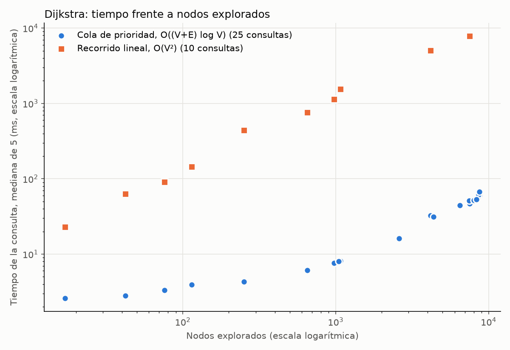

# Notas R2 — Caminos mínimos (Dijkstra)

Archivos: `src/quindio/dijkstra.py`, `src/quindio/estructuras.py` (montículo propio),
`experimentos/r2_dijkstra.py`, `experimentos/r2_matriz.py`, `experimentos/r2_figuras.py`,
`specs/R2.md`, `tests/test_r2.py`. Ejemplo a mano para la sustentación: `docs/paso_a_paso_R2.md`.

Máquina (`resultados/maquina.json`): Intel Core i5-12450H (12 núcleos lógicos), 31.6 GB de RAM,
Windows 11 (build 26200), Python 3.11.15. Semilla: `config.SEMILLA = 2026`. Mediciones:
5 repeticiones, mediana, milisegundos, solo el algoritmo (el grafo ya cargado en memoria;
sin lectura de archivos ni impresión), límite de 5 min por ejecución.

---

## 1. El problema

Dado el grafo dirigido de la red vial del Quindío (componente fuertemente conexa de R1:
V = 8 792 nodos, E = 19 999 aristas en `data/processed/aristas.csv`: las 20 136 de la componente menos 137 paralelas, de las que R1 conservó la de menor tiempo) con peso = tiempo de viaje
en segundos, encontrar el tiempo mínimo y la ruta entre dos lugares del catálogo, y la matriz
de tiempos mínimos entre todos los lugares (46 × 46). El grafo se lee con `red.cargar_grafo()`:
`adj[u] = [(v, tiempo_s, distancia_m), ...]`.

## 2. Algoritmos (implementación propia, "método largo")

Las dos versiones siguen el algoritmo de Dijkstra (E. W. Dijkstra, "A note on two problems in
connexion with graphs", *Numerische Mathematik* 1, 269-271, 1959; Cormen, Leiserson, Rivest y
Stein, *Introduction to Algorithms*, 3.ª ed., MIT Press, 2009, secc. 24.3). Ninguna usa
NetworkX, SciPy ni `heapq`: la cola de prioridad es el montículo propio `MonticuloMinimo`.
NetworkX se usa **solo** para verificar.

Pseudocódigo común:

1. `d[v] = ∞`, `pred[v] = ninguno`, `explorado[v] = falso` para todo v; `d[origen] = 0`.
2. Repetir: elegir el nodo no explorado u de menor `d`; si no hay ninguno con `d` finita, parar
   (destino inalcanzable); marcar u como explorado y contarlo; si u es el destino, parar;
   relajar cada arista (u, v, t): si `d[u] + t < d[v]` entonces `d[v] = d[u] + t`, `pred[v] = u`.
3. Reconstruir la ruta desde el destino siguiendo `pred` (`reconstruir_ruta`).

Ambas devuelven `(tiempo_s, ruta, nodos_explorados)`. Un nodo se cuenta como explorado una sola
vez, cuando se elige (la primera vez que sale de la cola).

### 2.1 Versión lineal — `dijkstra_lineal(adj, origen, destino, traza=None)`

El paso "elegir el mínimo" recorre todos los nodos con un bucle `for` y se queda con el no
explorado de menor distancia (diccionarios `distancia`, `explorado` de V entradas = el
"arreglo de distancias").

- **Tiempo**: el bucle principal se repite a lo sumo V veces y cada búsqueda del mínimo
  recorre V nodos → O(V²); las relajaciones suman O(E) en total (cada arista se mira una vez,
  cuando se explora su origen). Total **O(V² + E) = O(V²)**. Con parada temprana tras explorar
  k nodos: Θ(k · V). Fuente: Cormen et al. 2009, secc. 24.3, análisis de Dijkstra con la cola
  guardada en un arreglo indexado por vértice: cada EXTRACT-MIN cuesta O(V) y el total es
  O(V² + E) = O(V²).
- **Memoria**: O(V) (tres diccionarios de V entradas: distancia, predecesor, explorado).

### 2.2 Versión con cola de prioridad — `dijkstra_cola(adj, origen, destino=None, traza=None)`

El mínimo sale de un montículo binario mínimo propio con **inserción perezosa**: cuando la
distancia de v mejora se inserta un par nuevo `(d[v], v)`, sin buscar ni borrar el viejo. Al
extraer un par cuyo nodo ya está explorado, es **obsoleto** y se descarta sin contarlo.
Sin destino (`destino=None`) recorre todo el grafo y devuelve
`(distancias, predecesores, nodos_explorados)`: es el modo uno-a-todos usado para la matriz.

- **Montículo** (`estructuras.MonticuloMinimo`): arreglo con hijos de i en 2i + 1 y 2i + 2;
  `insertar` agrega al final y llama a `subir`; `extraer_minimo` saca la raíz, pone el último
  arriba y llama a `bajar`. Ambas recorren a lo sumo la altura ⌊log₂ n⌋ → **O(log n)** por
  operación, memoria O(n) (Cormen et al. 2009, secc. 6.1: la altura de un montículo de n elementos es
  ⌊lg n⌋; secc. 6.5: operaciones de cola de prioridad en O(lg n)).
- **Tiempo de Dijkstra**: cada relajación exitosa hace una inserción, así que hay como mucho
  E + 1 inserciones y E + 1 extracciones; el montículo tiene a lo sumo E + 1 pares, y cada
  operación cuesta O(log E) = O(log V) porque E ≤ V² ⇒ log E ≤ 2 log V. Más la inicialización
  O(V): **O((V + E) log V)**. Fuente: Cormen et al. 2009, secc. 24.3 (con montículo binario el
  total es O((V + E) lg V)); la variante perezosa se analiza igual cambiando DECREASE-KEY por
  INSERT (Sedgewick y Wayne, *Algorithms*, 4.ª ed., Addison-Wesley, 2011, secc. 4.4, versión
  "lazy" de Dijkstra: espacio O(E) y tiempo O(E log E) en el peor caso).
- **Memoria**: O(V + E): diccionarios de V entradas más hasta E + 1 pares en el montículo.

### 2.3 Recurrencia

Dijkstra no es recursivo; su correctitud se expresa con la recurrencia de los caminos mínimos
(principio de optimalidad, Cormen et al. 2009, lema 24.1: todo subcamino de un camino
mínimo es mínimo):

δ(s, s) = 0,  δ(s, v) = min sobre aristas (u, v) de { δ(s, u) + w(u, v) }.

Dijkstra la evalúa en orden creciente de δ: cuando explora v, todos los u con δ(s, u) < δ(s, v)
ya fueron explorados y relajados.

## 3. Correctitud

- **Invariante** (Cormen et al. 2009, teorema 24.6, correctitud de Dijkstra):
  al marcar un nodo u como explorado, `d[u] = δ(origen, u)`, el tiempo mínimo real. Además,
  en todo momento `d[v] ≥ δ(origen, v)` para todo v (propiedad de la cota superior, lema 24.11)
  y `d[v]` es el mínimo sobre caminos cuyos nodos intermedios están todos explorados.
- **Por qué se cumple**: supongamos que u es el primer nodo explorado con `d[u] > δ(s, u)`.
  Tomemos un camino mínimo de s a u; sea y el primer nodo del camino no explorado y x su
  anterior (explorado). Al explorar x se relajó (x, y), así que `d[y] = δ(s, y)`. Como los
  pesos son **no negativos**, δ(s, y) ≤ δ(s, u) < d[u]; pero el algoritmo eligió u y no y, o sea
  `d[u] ≤ d[y]`. Contradicción.
- **Por qué se puede parar al sacar el destino**: por el invariante, en ese instante
  `d[destino]` ya es δ(origen, destino); las iteraciones siguientes solo exploran nodos con
  distancia ≥ d[destino] y no pueden bajarla. Esto ahorra trabajo en consultas cortas
  (17 nodos explorados de 8 792 en DPA → PAN).
- **Condición sobre los pesos**: deben ser **no negativos**. Con un peso negativo, un nodo y
  con d[y] mayor podría llevar a u por un camino más barato después de haber fijado u, y el
  argumento falla (Cormen et al. 2009, secc. 24.3 exige pesos no negativos). Aquí
  los pesos son tiempos de viaje: en R1 se comprobó que `tiempo_s > 0` en todas las aristas
  (`test_componente_procesada_fuertemente_conexa`).
- **Inserción perezosa**: no cambia el invariante; un par obsoleto (d', v) con v ya explorado
  tiene d' ≥ d[v] y se descarta, así que cada nodo se explora una sola vez y con su distancia
  mínima (la primera vez que sale es con la menor prioridad que tuvo).

## 4. Verificación

1. **Pruebas** (`tests/test_r2.py`, 8 pruebas en verde):

| Prueba | Qué comprueba |
|---|---|
| `test_grafo_a_mano[lineal/cola]` | grafo de 6 nodos resuelto a mano: A→F = 12, ruta A-C-B-D-E-F, 6 explorados; A→B = 3 con 3 explorados; origen = destino |
| `test_uno_a_todos_a_mano` | distancias desde A a todos y predecesores |
| `test_inalcanzable[lineal/cola]` | destino sin camino → (∞, [], 3) |
| `test_traza_no_cambia_resultado` | el parámetro `traza` no altera el resultado |
| `test_lineal_igual_a_cola_y_a_networkx_en_grafo_aleatorio` | 300 nodos, ~1 500 aristas, pesos reales (semilla 2026): mismo tiempo y mismos explorados en las dos versiones, igual a `nx.dijkstra_path_length`; la ruta suma su tiempo; uno-a-todos igual a `nx.single_source_dijkstra_path_length` |
| `test_monticulo_igual_que_heapq` | 200 inserciones con extracciones intercaladas salen en el mismo orden que con `heapq` |

2. **En la red real, antes de medir** (`experimentos/r2_dijkstra.py`): en los 25 pares la
   versión con cola da el mismo tiempo que `networkx.dijkstra_path_length` sobre el grafo
   procesado (`MultiDiGraph` con peso `tiempo_s`), y en los 10 pares cercanos la versión
   lineal da el mismo tiempo que la de cola. Diferencia máxima: **0.0 s** en los 25 pares
   (`resultados/r2_verificacion.csv`, columnas `tiempo_cola_s, tiempo_lineal_s,
   tiempo_networkx_s, dif_max_s, coincide`). En los 10 pares medidos con ambas, las dos
   versiones también exploran el mismo número de nodos (`resultados/r2_dijkstra.csv`).
3. **Matriz**: cada fila se compara con `nx.single_source_dijkstra_path_length`; diferencia
   máxima 0.0 s en las 46 × 46 celdas.

## 5. Elección de los pares

- **10 pares cercanos** (medidos con las dos versiones): criterio = **ambos lugares del mismo
  municipio** y en nodos distintos. Se listan todos los pares ordenados (origen, destino) que
  cumplen eso y se eligen 10 al azar con `random.Random(2026).sample`. Quedaron pares de
  Salento, Quimbaya, Armenia, Calarcá y Génova. "Mismo municipio" no siempre significa pocos
  nodos explorados: MOQ → BAM (Armenia, casco urbano → corregimiento El Caimo) exploró 7 531.
- **15 pares adicionales** (solo con cola): con el mismo generador, 15 pares al azar entre
  lugares de **municipios distintos**. Total con cola: 25 pares (≥ 20 pedidos).

## 6. Resultados

### 6.1 Mediciones de Dijkstra (`resultados/r2_dijkstra.csv`)

Columnas del anexo `origen,destino,version,tiempo_viaje_s,nodos_explorados,tiempo_ms`; el CSV
agrega `nodo_origen, nodo_destino, nodos_ruta, tipo_par, municipio_origen, municipio_destino,
completada`. Todas las ejecuciones se completaron dentro de los 5 min.

| origen | destino | version | tiempo_viaje_s | nodos_explorados | tiempo_ms | par |
|---|---|---|---|---|---|---|
| SAL | ACR | cola_prioridad | 53.45 | 42 | 2.825 | cercano (Salento → Salento) |
| SAL | ACR | lineal | 53.45 | 42 | 63.187 | cercano (Salento → Salento) |
| ARR | CQB | cola_prioridad | 500.82 | 114 | 3.941 | cercano (Quimbaya → Quimbaya) |
| ARR | CQB | lineal | 500.82 | 114 | 144.886 | cercano (Quimbaya → Quimbaya) |
| DEL | COC | cola_prioridad | 2019.85 | 1076 | 8.143 | cercano (Salento → Salento) |
| DEL | COC | lineal | 2019.85 | 1076 | 1545.266 | cercano (Salento → Salento) |
| DEL | OCA | cola_prioridad | 1265.7 | 252 | 4.315 | cercano (Salento → Salento) |
| DEL | OCA | lineal | 1265.7 | 252 | 442.555 | cercano (Salento → Salento) |
| ALM | MOQ | cola_prioridad | 857.19 | 4172 | 32.462 | cercano (Armenia → Armenia) |
| ALM | MOQ | lineal | 857.19 | 4172 | 5046.368 | cercano (Armenia → Armenia) |
| QUI | DPA | cola_prioridad | 995.84 | 977 | 7.597 | cercano (Quimbaya → Quimbaya) |
| QUI | DPA | lineal | 995.84 | 977 | 1137.346 | cercano (Quimbaya → Quimbaya) |
| MOQ | BAM | cola_prioridad | 2380.26 | 7531 | 46.889 | cercano (Armenia → Armenia) |
| MOQ | BAM | lineal | 2380.26 | 7531 | 7804.492 | cercano (Armenia → Armenia) |
| CMB | CAL | cola_prioridad | 882.22 | 654 | 6.1 | cercano (Calarcá → Calarcá) |
| CMB | CAL | lineal | 882.22 | 654 | 760.361 | cercano (Calarcá → Calarcá) |
| LMA | GEN | cola_prioridad | 365.11 | 76 | 3.302 | cercano (Génova → Génova) |
| LMA | GEN | lineal | 365.11 | 76 | 90.748 | cercano (Génova → Génova) |
| DPA | PAN | cola_prioridad | 129.35 | 17 | 2.607 | cercano (Quimbaya → Quimbaya) |
| DPA | PAN | lineal | 129.35 | 17 | 22.791 | cercano (Quimbaya → Quimbaya) |
| ARR | CGE | cola_prioridad | 7013.13 | 8750 | 61.739 | otro (Quimbaya → Génova) |
| ALM | COC | cola_prioridad | 3909.26 | 8597 | 57.624 | otro (Armenia → Salento) |
| MMQ | SAB | cola_prioridad | 2784.5 | 8050 | 52.537 | otro (Armenia → Buenavista) |
| FUN | PAN | cola_prioridad | 2741.05 | 8005 | 52.519 | otro (Armenia → Quimbaya) |
| CQB | FUN | cola_prioridad | 1927.82 | 4374 | 31.476 | otro (Quimbaya → Armenia) |
| GRA | CMB | cola_prioridad | 3288.09 | 1045 | 8.056 | otro (Pijao → Calarcá) |
| FES | CGE | cola_prioridad | 6132.3 | 8748 | 60.292 | otro (Montenegro → Génova) |
| FES | PBL | cola_prioridad | 2967.32 | 7492 | 50.967 | otro (Montenegro → Calarcá) |
| MML | ACR | cola_prioridad | 3756.95 | 8030 | 51.753 | otro (Quimbaya → Salento) |
| LMA | DPA | cola_prioridad | 7737.8 | 8499 | 55.451 | otro (Génova → Quimbaya) |
| FES | GRA | cola_prioridad | 5006.92 | 8607 | 61.586 | otro (Montenegro → Pijao) |
| OCA | ARR | cola_prioridad | 2899.53 | 6492 | 44.52 | otro (Salento → Quimbaya) |
| CRS | ARM | cola_prioridad | 2271.86 | 2603 | 16.17 | otro (Salento → Armenia) |
| SAL | SAB | cola_prioridad | 4927.06 | 8322 | 53.481 | otro (Salento → Buenavista) |
| ARM | GEN | cola_prioridad | 5807.7 | 8723 | 67.338 | otro (Armenia → Génova) |

**Discusión.** El número de nodos explorados depende del tiempo de viaje del par, no de la
distancia en línea recta ni del municipio: Dijkstra explora "en círculos de tiempo" alrededor
del origen, así que una consulta de 129 s explora 17 nodos y una de 7 000 s explora casi toda
la red (8 750 de 8 792). Dentro de Armenia, ALM → MOQ (857 s) explora 4 172 nodos porque el
casco urbano es denso, mientras que QUI → DPA (996 s, zona rural de Quimbaya) explora 977. Esto
coincide con la teoría: Dijkstra extrae los nodos en orden creciente de distancia y se detiene
al llegar al destino.

### 6.2 Gráfica tiempo vs nodos explorados

`resultados/figuras/r2_tiempo_vs_nodos.png` (generada por `experimentos/r2_figuras.py` a
partir de `resultados/r2_dijkstra.csv`). Ambos ejes en **escala logarítmica**, porque los
nodos van de 17 a 8 750 y los tiempos de 2.6 ms a 7 804 ms (tres órdenes de magnitud).

**Discusión.** Con V fijo (8 792), la teoría predice para la lineal un tiempo Θ(k · V) para k
nodos explorados, es decir, lineal en k: en escala log-log, una recta de pendiente 1. El
ajuste por mínimos cuadrados de log(tiempo) contra log(k) da **pendiente 0.96**, y el costo por
nodo revisado en la búsqueda del mínimo, tiempo / (k · V), queda entre 118 y 200 ns (mediana
141 ns): cada paso recorre los 8 792 nodos aunque solo se exploren 17. Para la versión con cola
la pendiente cruda es 0.59, más baja de lo esperado para O(k log k): la razón es un **piso fijo
de ≈ 2.5 ms** que no depende de k, la inicialización O(V) de los tres diccionarios
(`distancia`, `predecesor`, `explorado` para los 8 792 nodos; medida aparte: 2.52 ms). Ese piso
domina en las consultas cortas (2.6 ms con 17 nodos). Restando el piso, la pendiente sube a
**0.97** y el tiempo por unidad de k · log₂ k queda alrededor de 0.52 µs (mediana), consistente
con O((k + aristas relajadas) log k) más O(V). La separación vertical entre las dos nubes
(dos órdenes de magnitud) refleja que la lineal paga V comparaciones por nodo explorado y la de
cola solo O(log V) más sus relajaciones.

### 6.3 Cociente entre versiones (`resultados/r2_cociente.csv`)

En los 10 pares medidos con ambas (cociente = tiempo lineal / tiempo cola; detalle por par en
`resultados/r2_cociente_pares.csv`):

| Mediana | Mínimo | Máximo |
|---|---|---|
| 113.61 | 8.74 | 189.77 |

| origen | destino | nodos explorados | lineal (ms) | cola (ms) | cociente |
|---|---|---|---|---|---|
| DPA | PAN | 17 | 22.791 | 2.607 | 8.74 |
| SAL | ACR | 42 | 63.187 | 2.825 | 22.37 |
| LMA | GEN | 76 | 90.748 | 3.302 | 27.48 |
| ARR | CQB | 114 | 144.886 | 3.941 | 36.76 |
| DEL | OCA | 252 | 442.555 | 4.315 | 102.56 |
| CMB | CAL | 654 | 760.361 | 6.100 | 124.65 |
| QUI | DPA | 977 | 1137.346 | 7.597 | 149.71 |
| DEL | COC | 1076 | 1545.266 | 8.143 | 189.77 |
| ALM | MOQ | 4172 | 5046.368 | 32.462 | 155.45 |
| MOQ | BAM | 7531 | 7804.492 | 46.889 | 166.45 |

**Discusión.** La versión con cola es siempre más rápida y la ventaja crece con k, como predice
la teoría: el cociente es aproximadamente (k · V) / (V + k log k). Con k pequeño el denominador
lo domina el piso de ≈ 2.5 ms de la inicialización O(V), mientras la lineal paga ≈ 1.2 ms por
nodo explorado (8 792 comparaciones), así que el cociente crece casi proporcional a k:
≈ (1.2 k + 2.5) / 2.6 ≈ 0.5 k (17 nodos → 8.7; 42 → 22.4; 114 → 36.8). Con k grande el cociente tiende a V / log V
(8 792 / log₂ 8 792 ≈ 670 en el modelo ideal); medido se estabiliza en 150-190 porque las
operaciones del montículo propio escrito en Python (llamadas a métodos, intercambios en la
lista) tienen una constante mayor que un recorrido simple del diccionario, y porque la
inserción perezosa mete más pares que nodos en la cola. El máximo (189.8) es DEL → COC y no el
par con más nodos: en ALM → MOQ y MOQ → BAM el cociente baja a 155-166 porque el costo por nodo
de la versión con cola crece con k (≈ 5.2 µs por nodo con k ≈ 1 000 y 5.9-7.2 µs con
k = 4 000-7 500, por el factor log k y un montículo más grande), mientras que en la lineal el
costo por nodo revisado tiende a bajar cuando ya hay muchos explorados (118 ns con k = 7 531
frente a 163 ns con k = 1 076), porque para esos se salta la comparación de distancia.

### 6.4 Matriz de tiempos (`resultados/matriz_tiempos.csv`)

46 × 46 (los 46 lugares del catálogo, incluida la Plaza de Bolívar de Armenia, `ARM`). Primera
fila y primera columna = ids; celda (i, j) = segundos de i a j, redondeados a 0.01 s. Construida
con `dijkstra_cola` **sin destino**, una vez desde cada lugar (46 ejecuciones uno-a-todos).
Resumen en `resultados/r2_matriz_resumen.json`:

| Medida | Valor |
|---|---|
| Lugares | 46 (46 Dijkstra uno-a-todos) |
| Tiempo total de construcción (mediana de 5) | 2 612.5 ms |
| Tiempo por fila (uno-a-todos) | 56.79 ms |
| Tiempo máximo en la matriz | 9 382.75 s (156.4 min) |
| Mediana fuera de la diagonal | 43.9 min |
| Asimetría máxima \|t_ij − t_ji\| | 545.33 s, entre FIL y BBR (FIL → BBR 1 213.11 s; BBR → FIL 1 758.44 s) |
| Asimetría media (1 035 pares) | 50.29 s |
| Asimetría relativa máxima | 65.7 % |
| Diferencia máxima con NetworkX | 0.0 s |

**Discusión.** Una ejecución uno-a-todos explora los 8 792 nodos; cuesta ≈ 57 ms, en línea con
las consultas punto a punto que exploraron casi toda la red (55-67 ms con 8 500-8 750 nodos).
Las 46 filas cuestan 46 × O((V + E) log V); la alternativa de correr 46 × 45 consultas punto a
punto costaría unas 45 veces más en el peor caso, por eso se usó el modo sin destino. La matriz
**no es simétrica** porque la red es dirigida: hay vías de un solo sentido. En el par más
asimétrico, la ruta FIL → BBR mide 11.5 km y 11 de sus 15 tramos no tienen arista en sentido
contrario (sentidos únicos en OSM), así que la vuelta BBR → FIL toma otra ruta de 17.9 km. Por
eso R4 debe usar t_ij y t_ji por separado.

## 7. Supuestos y limitaciones

- El tiempo de una ruta es entre los **nodos** asociados a los lugares; los 7 lugares a más de
  500 m de su nodo (ver `docs/notas_R1.md`, "Lugares a más de 500 m") no incluyen el último
  tramo.
- Los tiempos usan velocidades de flujo libre (límite legal o imputado, R1): no hay tráfico,
  semáforos ni giros.
- La inicialización O(V) se incluyó en ambas versiones (como INITIALIZE-SINGLE-SOURCE de Cormen
  et al.). Una inicialización perezosa (crear la distancia de un nodo al descubrirlo) quitaría el
  piso de 2.5 ms de las consultas cortas con cola, pero se dejó la forma del libro por claridad.
